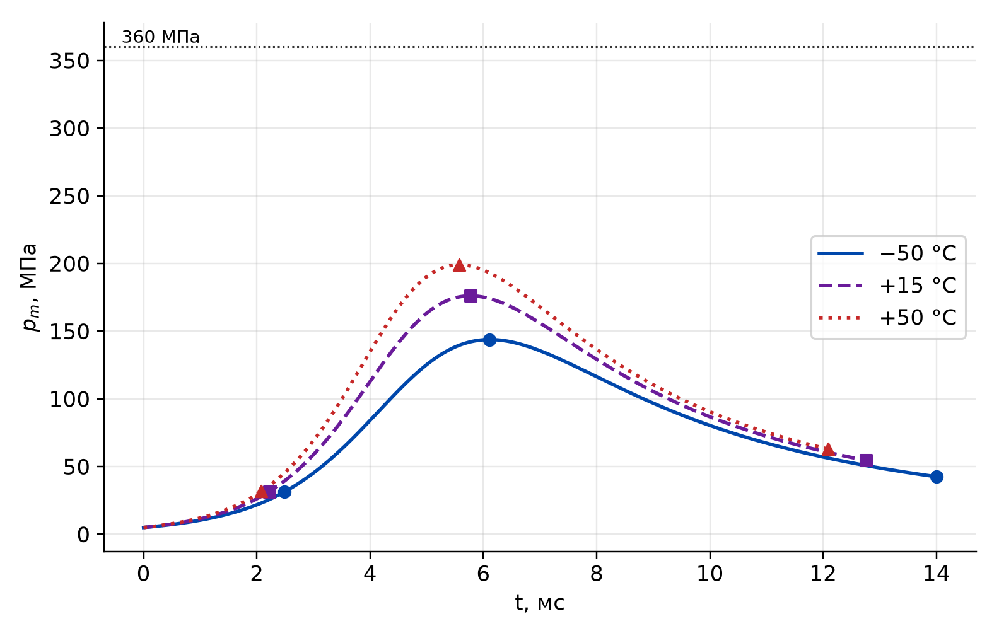
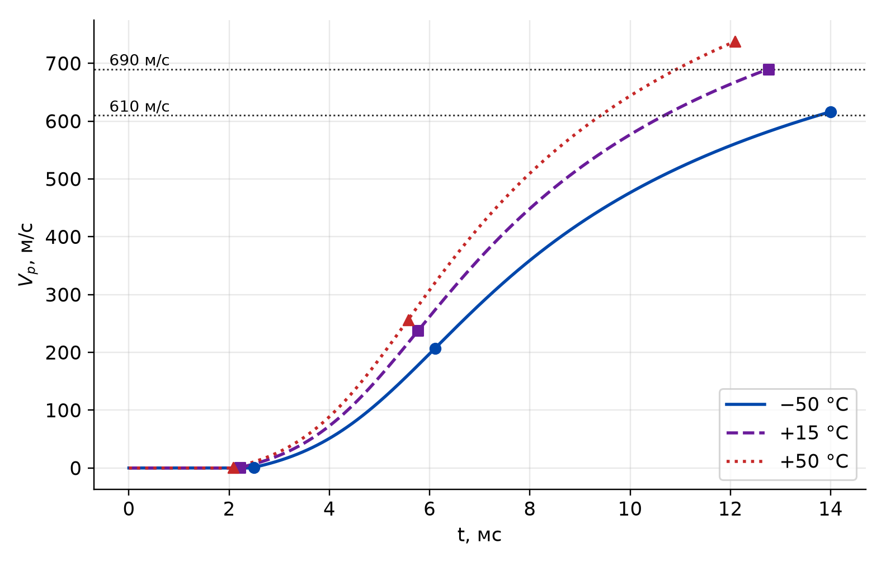
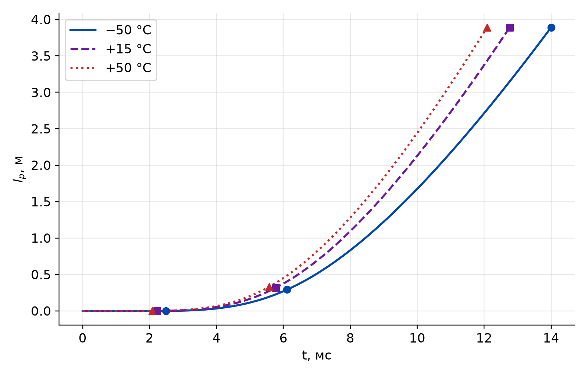
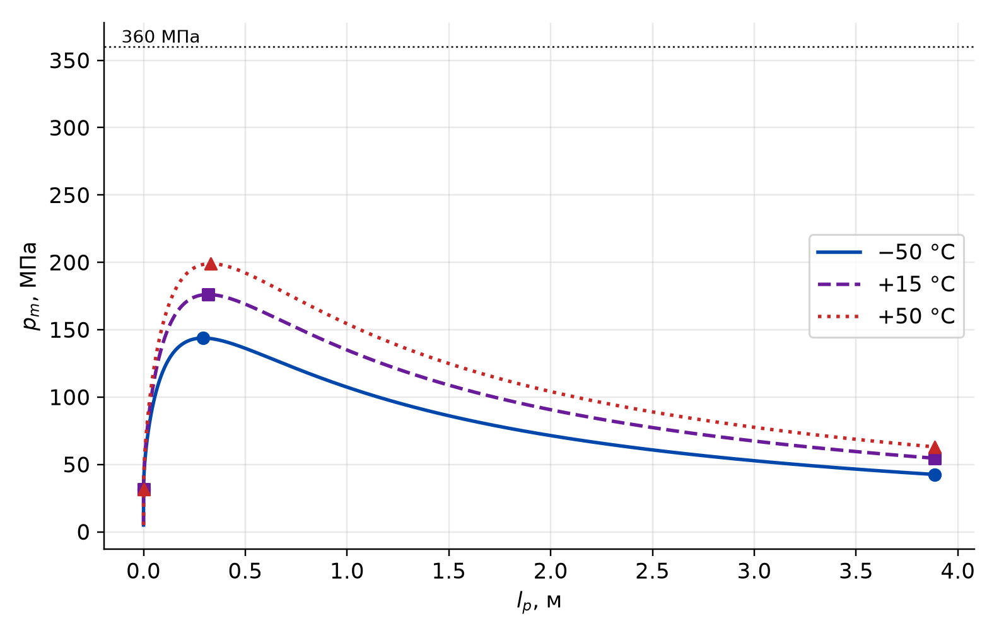
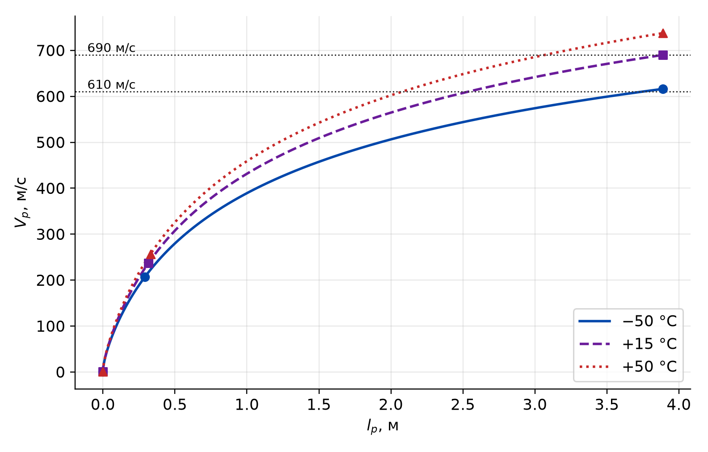
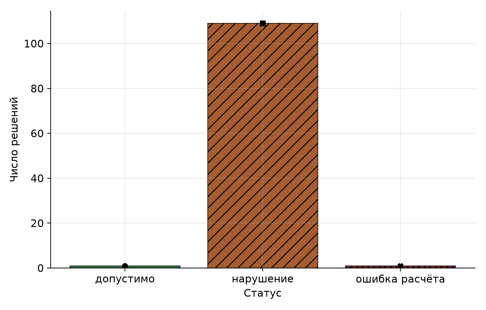
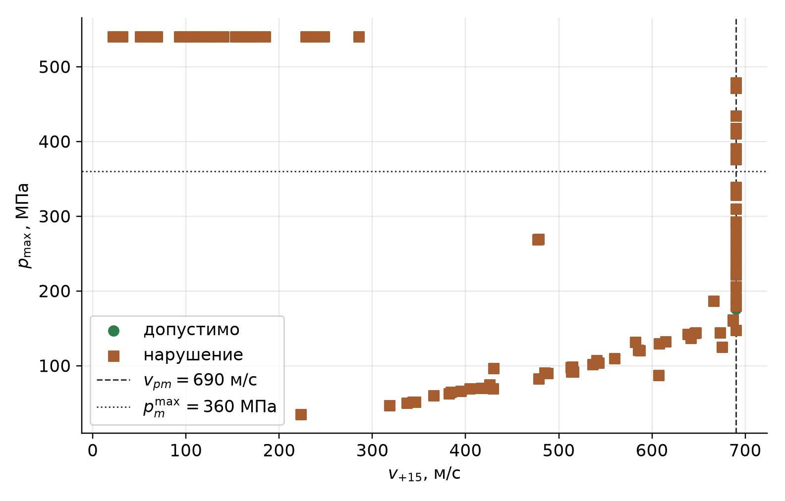
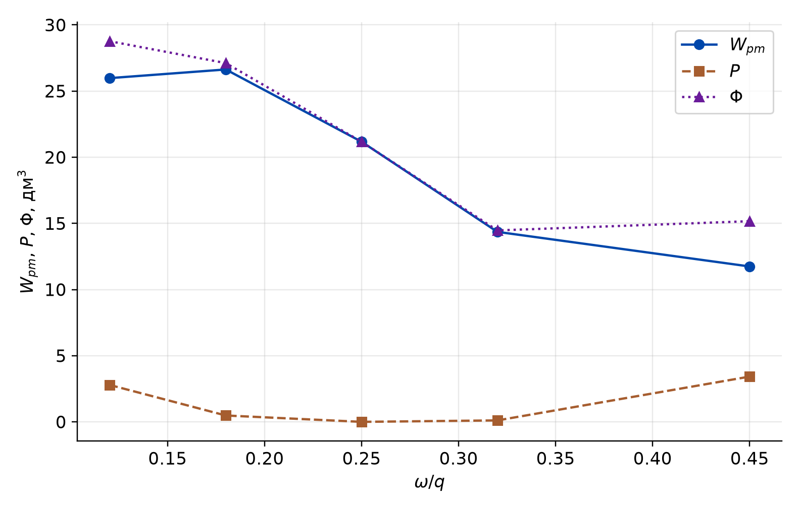

<div align="center">

Федеральное государственное бюджетное образовательное учреждение  
высшего образования  
«Московский государственный технический университет  
имени Н. Э. Баумана  
(национальный исследовательский университет)»  
(МГТУ им. Н. Э. Баумана)

Кафедра «Ракетные и импульсные системы»

**ЛАБОРАТОРНАЯ РАБОТА № 1**  
по дисциплине «Информационные технологии при проектировании РиСО»

**Markdown, LaTeX и воспроизводимый отчёт  
по прямому баллистическому расчёту**

</div>
Обезличенная работа LR1-021


<div align="center">

Москва 2026

</div>

<!-- Разрыв страницы -->

# ВВЕДЕНИЕ

Цель работы — освоить воспроизводимый цикл прямого баллистического расчёта и технического отчёта: программа на Python в виде `uv`-проекта, формулы в LaTeX, результаты в таблицах и на графиках, сборка PDF [1; 3].

Предмет — прямая задача внутренней баллистики варианта 9. Математическая модель — нульмерная термодинамическая модель среднего давления `ozvb_termo` библиотеки `pyballistics` 1.2.1 [2]. Проверяются критерий \(W_{pm}\), общие и индивидуальные ограничения и квадратичный внешний штраф.

<!-- Разрыв страницы -->

# 1 Вариант и замысел проверки

## 1.1 Исходные данные и математическая постановка

Вариант 9: нарезной ствол, \(d = 76{,}2\) мм, \(q = 7{,}1\) кг, \(n_S = 1{,}04\), \(\varphi_1 = 1{,}02\) [1]. Давление воспламенителя \(p_{\mathrm{ign}\,0} = 5\) МПа, давление форсирования \(p_0 = 30\) МПа. Температуры заряда: \(-50\), \(+15\) и \(+50\) °C. Нормальная температура принята \(+15\) °C.

Площадь канала и объём каморы:

$$
S = n_S \pi d^2 / 4, \qquad W_0 = \omega / \Delta. \tag{1}
$$

где \(S\) — площадь канала, м²; \(W_0\) — объём каморы, м³; \(\omega\) — масса заряда, кг; \(\Delta\) — плотность заряжания, кг/м³.

Критерий (минимум) — объём заснарядного пространства в момент достижения требуемой скорости при \(+15\) °C:

$$
W_{pm} = W_0 + S\, l_m. \tag{2}
$$

где \(l_m\) — длина ведущей части ствола. Если решение останавливается раньше (по пути или по давлению), в (2) подставляется путь в точке остановки, а недобор скорости фиксируется ограничением.

Ограничения записаны как \(g_i \le 0\):

$$
\begin{aligned}
g_v &= 690 - v_{+15}, \\
g_p &= p_{\max} - 360\cdot 10^6, \\
g_l &= l_m - 65d, \\
g_{v,-50} &= 610 - v_{-50}, \\
g_a &= g_{p,+50} - 14000.
\end{aligned} \tag{3}
$$

где \(v_{+15}\) и \(p_{\max}\) — дульная скорость и максимум среднего давления при \(+15\) °C, м/с и Па; \(v_{-50}\) — скорость при \(-50\) °C на стволе длины \(l_m\), м/с; \(g_{p,+50}\) — наибольшее ускорение снаряда при \(+50\) °C в единицах \(g\). Ускорение оценивается по конечным разностям ряда \(v_p(t)\), потому что `ozvb_termo` его явно не возвращает.

Порядок расчёта одного решения: при \(+15\) °C остановка по \(v_p = 690\) м/с (предохранители \(x_p = 1{,}05\cdot 65d\) и \(p_{\max} = 1{,}5\cdot 360\) МПа); затем при \(-50\) и \(+50\) °C остановка по уже найденному \(x_p = l_m\).

## 1.2 Выбранная организация расчёта

Вход функции `evaluate` — марка пороха из базы `pyballistics`, масса \(\omega\) и плотность \(\Delta\). Выход — статус, исходный критерий \(W_{pm}\), штраф \(P\), критерий со штрафом \(\Phi\), вектор \(g_i\) и значения \(t\), \(p_m\), \(v_p\), \(x_p\) для графиков.

Статусы разделены. `ok` — все ограничения удовлетворены. `violated` — расчёт завершился, но хотя бы одно ограничение не удовлетворено. `calc_error` — исключение или причина останова вне допустимого набора \(v_p\), \(x_p\), \(p_{\max}\) (в том числе исчерпание числа шагов и неизвестная марка). Для такого результата \(P\) и \(\Phi\) не вычисляются: ошибка численного расчёта не записывается как нарушение ограничения и не прибавляется к критерию.

## 1.3 Штрафная функция

Выбран нормированный квадратичный внешний штраф. Масштабы \(s_i\) равны пределам из (3): 690 м/с, 360 МПа, \(65d\), 610 м/с и \(14000\,g\).

$$
\nu_i = \max\left(0, \frac{g_i}{s_i}\right), \qquad
P = \mu \sum_i \nu_i^2, \qquad
\Phi = W_{pm} + P, \qquad
\mu = 0{,}01~\text{м}^3. \tag{4}
$$

где \(\nu_i\) — безразмерная нормированная величина нарушения; \(P\) — штраф, м³; \(\Phi\) — критерий со штрафом, м³. Коэффициент \(\mu\) имеет размерность м³, поэтому сложение \(W_{pm}+P\) корректно. Квадрат усиливает крупные нарушения и равен нулю на допустимой границе. В таблицах \(W_{pm}\), \(P\) и \(\Phi\) приведены отдельно. При `calc_error` формула (4) не применяется.

## 1.4 Замысел графиков и инфографики

Рисунки 1–5 отвечают на вопрос, выполняет ли программа прямой расчёт допустимого решения: давление, скорость и путь при трёх температурах, от времени и от пути. Маркеры — начало движения (\(V_p > 1\) м/с), максимум давления и дульный срез. Горизонтальные линии — пределы 360 МПа, 690 м/с и 610 м/с. Линии температур различаются типом штриха и формой маркера.

Рисунок 6 показывает, что набор содержит все три статуса. Рисунок 7 проверяет ограничения по скорости и давлению при \(+15\) °C: допустимая точка должна лежать на линии 690 м/с и ниже 360 МПа. Рисунок 8 отделяет \(W_{pm}\) от \(P\) и \(\Phi\) вдоль \(\omega/q\) при фиксированных марке `22/1 тр` и \(\Delta = 650\) кг/м³.

<!-- Разрыв страницы -->

# 2 Выбор баллистических решений и результаты

## 2.1 Выбранные решения

Набор задан в коде, без случайного поиска. В него входят все 102 марки базы `pyballistics` при одном заряжании \(\omega/q = 0{,}25\) и \(\Delta = 650\) кг/м³.

Для марки `22/1 тр` заданы два одномерных сдвига. Первый меняет \(\omega/q\) при \(\Delta = 650\) кг/м³: значения \(0{,}12\), \(0{,}18\), \(0{,}32\) и \(0{,}45\). Второй меняет \(\Delta\) при \(\omega/q = 0{,}25\): \(350\), \(500\), \(850\) и \(1100\) кг/м³. Эти точки проводят решение через недобор скорости, упор в длину ствола, рост ускорения и упор в давление. Имя `__no_such_powder__` — контрольный нерассчитываемый вызов.

## 2.2 Результаты и анализ

Программа `uv run python main.py` печатает `pyballistics=1.2.1` и строку по каждому решению. Из 102 марок при выбранном заряжании допустима одна: `22/1 тр`. Для неё \(W_{pm} = 0{,}02117\) м³, \(P = 0\), \(\Phi = W_{pm}\). Остановка при \(+15\) °C произошла по скорости. \(p_{\max} = 176\) МПа, \(l_m = 3{,}89\) м, \(v_{-50} = 616\) м/с, \(g_{p,+50} = 1{,}23\cdot 10^4\,g\). Все \(g_i \le 0\). Остальные 101 марка нарушают хотя бы одно ограничение.

Рисунки 1–3 построены по этому решению. Давление остаётся ниже 360 МПа, к дульному срезу скорость выходит на заданные уровни, путь растёт монотонно. С ростом температуры максимум давления наступает раньше и выше, что согласуется с температурной зависимостью горения в модели.



Рисунок 1 — \(p_m(t)\) допустимого решения `22/1 тр` при трёх температурах



Рисунок 2 — \(V_p(t)\) допустимого решения и пределы 690 и 610 м/с



Рисунок 3 — \(l_p(t)\) допустимого решения



Рисунок 4 — \(p_m(l_p)\) допустимого решения и предел 360 МПа



Рисунок 5 — \(V_p(l_p)\) допустимого решения

Таблица 1 собирает все марки базы и строку нерассчитываемого вызова. Для `calc_error` вместо отсутствующих чисел стоит тире.

Таблица 1 — Прямой расчёт всех марок базы при $\omega/q = 0{,}25$, $\Delta = 650$ кг/м³

| Марка | Статус | $W_{pm}$, м³ | $P$, м³ | $\Phi$, м³ | $v_{+15}$, м/с | $p_{\max}$, МПа | $l_m$, м | $v_{-50}$, м/с | $g_{p,+50}$, $g$ |
|---|---|---:|---:|---:|---:|---:|---:|---:|---:|
| 100/56 | violated | 0,02740 | 0,000110 | 0,02751 | 642 | 137 | 5,20 | 574 | 9439 |
| 100/70 | violated | 0,01464 | 0,000155 | 0,01480 | 690 | 224 | 2,51 | 615 | 15744 |
| 11/1 БП | violated | 0,01531 | 0,000298 | 0,01561 | 690 | 222 | 2,65 | 594 | 16390 |
| 11/1 УГ | violated | 0,02740 | 0,005212 | 0,03261 | 343 | 51 | 5,20 | 295 | 3556 |
| 11/7 | violated | 0,00843 | 0,019595 | 0,02802 | 690 | 479 | 1,20 | 639 | 33043 |
| 12/1 Тр | violated | 0,00862 | 0,013510 | 0,02213 | 690 | 417 | 1,24 | 636 | 30119 |
| 12/1 УГ | violated | 0,02740 | 0,005945 | 0,03334 | 319 | 47 | 5,20 | 275 | 3192 |
| 12/1 тр БП | violated | 0,01531 | 0,000298 | 0,01561 | 690 | 222 | 2,65 | 594 | 16390 |
| 12/1 тр МН | violated | 0,00925 | 0,011648 | 0,02090 | 690 | 382 | 1,37 | 616 | 29086 |
| 12/7 | violated | 0,01056 | 0,003992 | 0,01455 | 690 | 310 | 1,65 | 624 | 22845 |
| 12/7 В/А | violated | 0,00873 | 0,015520 | 0,02425 | 690 | 434 | 1,27 | 635 | 31200 |
| 130/50 | violated | 0,02740 | 0,000962 | 0,02836 | 536 | 102 | 5,20 | 482 | 6923 |
| 130/58 БП | violated | 0,02740 | 0,003712 | 0,03111 | 395 | 66 | 5,20 | 347 | 4521 |
| 14/1 тр В/А | violated | 0,00804 | 0,019796 | 0,02783 | 690 | 471 | 1,12 | 641 | 33217 |
| 14/7 | violated | 0,01518 | 0,000022 | 0,01520 | 690 | 206 | 2,63 | 613 | 14663 |
| 14/7 БП | violated | 0,02740 | 0,001438 | 0,02883 | 514 | 92 | 5,20 | 442 | 6494 |
| 14/7 В/А | violated | 0,01096 | 0,002736 | 0,01369 | 690 | 293 | 1,73 | 624 | 21324 |
| 15/1 тр В/А | violated | 0,00884 | 0,010013 | 0,01885 | 690 | 391 | 1,29 | 634 | 27959 |
| 15/7 | violated | 0,01374 | 0,000228 | 0,01397 | 690 | 225 | 2,32 | 615 | 16116 |
| 152/57 | violated | 0,02740 | 0,003061 | 0,03046 | 417 | 70 | 5,20 | 376 | 4654 |
| 152/57 БП | violated | 0,02740 | 0,001800 | 0,02920 | 488 | 90 | 5,20 | 425 | 6285 |
| 152/57 Ш | violated | 0,02740 | 0,000886 | 0,02828 | 543 | 103 | 5,20 | 487 | 7053 |
| 16/1 тр | violated | 0,01326 | 0,000455 | 0,01372 | 690 | 241 | 2,22 | 615 | 16986 |
| 16/1 тр В/А | violated | 0,01094 | 0,002190 | 0,01313 | 690 | 291 | 1,73 | 619 | 20552 |
| 17/7 | violated | 0,02600 | 0,000000 | 0,02600 | 690 | 148 | 4,91 | 609 | 10302 |
| 18/1 тр | violated | 0,01239 | 0,000842 | 0,01323 | 690 | 256 | 2,04 | 615 | 18062 |
| 18/1 тр БП | violated | 0,02740 | 0,000521 | 0,02792 | 587 | 120 | 5,20 | 509 | 8568 |
| 180/57 | violated | 0,02740 | 0,000694 | 0,02809 | 560 | 109 | 5,20 | 502 | 7469 |
| 180/57 БП | violated | 0,02740 | 0,004456 | 0,03185 | 366 | 60 | 5,20 | 322 | 4071 |
| 180/57 Ш3 БП | violated | 0,02740 | 0,000048 | 0,02744 | 673 | 144 | 5,20 | 585 | 10298 |
| 180/60 | violated | 0,02740 | 0,003895 | 0,03129 | 382 | 62 | 5,20 | 346 | 4139 |
| 22/1 тр | ok | 0,02117 | 0 | 0,02117 | 690 | 176 | 3,89 | 616 | 12256 |
| 22/7 | violated | 0,02740 | 0,001267 | 0,02866 | 516 | 92 | 5,20 | 460 | 6227 |
| 37/1 тр | violated | 0,02740 | 0,003031 | 0,03043 | 418 | 70 | 5,20 | 378 | 4658 |
| 4/1 | violated | 0,00279 | 0,033223 | 0,03602 | 69 | 540 | 0,01 | 63 | 30904 |
| 4/1 фл | violated | 0,00292 | 0,032667 | 0,03559 | 117 | 540 | 0,04 | 105 | 31947 |
| 4/7 | violated | 0,00285 | 0,033555 | 0,03640 | 93 | 540 | 0,02 | 84 | 31777 |
| 4/7 ПТ-3 фл | violated | 0,00293 | 0,032775 | 0,03571 | 108 | 540 | 0,04 | 93 | 31691 |
| 4/7 Ц гр | violated | 0,00287 | 0,033562 | 0,03643 | 100 | 540 | 0,03 | 90 | 31978 |
| 4/7 св | violated | 0,00286 | 0,033892 | 0,03675 | 97 | 540 | 0,03 | 87 | 32067 |
| 4/7 фл ВБП | violated | 0,00309 | 0,031534 | 0,03463 | 157 | 540 | 0,08 | 138 | 32300 |
| 5/1 | violated | 0,00277 | 0,034973 | 0,03775 | 57 | 540 | 0,01 | 52 | 31536 |
| 5/1 д-20 | violated | 0,01364 | 0,011864 | 0,02551 | 690 | 376 | 2,30 | 643 | 29237 |
| 5/1 д-25 | violated | 0,02740 | 0,000038 | 0,02743 | 666 | 186 | 5,20 | 605 | 13871 |
| 5/1 х-10 | violated | 0,00303 | 0,032434 | 0,03546 | 153 | 540 | 0,06 | 131 | 32632 |
| 5/1 х-20 | violated | 0,01516 | 0,006456 | 0,02162 | 690 | 329 | 2,62 | 643 | 25249 |
| 5/7 Ц фл | violated | 0,00296 | 0,032662 | 0,03562 | 127 | 540 | 0,05 | 113 | 32176 |
| 5/7 в/а | violated | 0,00290 | 0,033749 | 0,03665 | 114 | 540 | 0,04 | 103 | 32447 |
| 5/7 н/а | violated | 0,00287 | 0,033329 | 0,03619 | 100 | 540 | 0,03 | 90 | 31841 |
| 5/7 св | violated | 0,00288 | 0,032713 | 0,03559 | 105 | 540 | 0,03 | 95 | 31647 |
| 6/7 БП гр | violated | 0,00338 | 0,029251 | 0,03263 | 230 | 540 | 0,14 | 204 | 32714 |
| 6/7 П-5 БП фл | violated | 0,00358 | 0,028908 | 0,03249 | 229 | 540 | 0,18 | 191 | 32369 |
| 6/7 гр | violated | 0,00311 | 0,031775 | 0,03488 | 173 | 540 | 0,08 | 155 | 32838 |
| 6/7 фл | violated | 0,00308 | 0,031614 | 0,03469 | 161 | 540 | 0,07 | 143 | 32452 |
| 6/7 фл В БП | violated | 0,00306 | 0,032543 | 0,03560 | 158 | 540 | 0,07 | 140 | 32866 |
| 7/1 | violated | 0,00294 | 0,033357 | 0,03630 | 128 | 540 | 0,04 | 116 | 32616 |
| 7/1 УГ | violated | 0,02740 | 0,002080 | 0,02948 | 479 | 82 | 5,20 | 406 | 5954 |
| 7/1 фл БП | violated | 0,00308 | 0,032166 | 0,03525 | 164 | 540 | 0,07 | 142 | 32772 |
| 7/7 | violated | 0,00316 | 0,030603 | 0,03376 | 185 | 540 | 0,09 | 166 | 32491 |
| 8/1 УГ | violated | 0,02740 | 0,003062 | 0,03046 | 430 | 69 | 5,20 | 365 | 4956 |
| 8/1 тр | violated | 0,00344 | 0,028966 | 0,03240 | 248 | 540 | 0,15 | 222 | 32952 |
| 8/7 | violated | 0,00311 | 0,031159 | 0,03426 | 171 | 540 | 0,08 | 152 | 32451 |
| 9/7 | violated | 0,00368 | 0,027380 | 0,03106 | 285 | 540 | 0,20 | 252 | 32783 |
| 9/7 БП | violated | 0,01774 | 0,000013 | 0,01775 | 690 | 190 | 3,16 | 592 | 14266 |
| 9/7 МН | violated | 0,01030 | 0,007999 | 0,01830 | 690 | 338 | 1,60 | 610 | 26521 |
| АПЦ-235 П 16/1 | violated | 0,01159 | 0,001958 | 0,01355 | 690 | 273 | 1,87 | 593 | 20183 |
| БНГ-1355 25/1 | violated | 0,01360 | 0,000532 | 0,01413 | 690 | 235 | 2,29 | 596 | 17212 |
| ВТ | violated | 0,00274 | 0,033817 | 0,03656 | 32 | 540 | 0,00 | 29 | 30058 |
| ВТД-25 | violated | 0,00337 | 0,029744 | 0,03311 | 237 | 540 | 0,13 | 206 | 33066 |
| ВТМ | violated | 0,00277 | 0,034249 | 0,03701 | 51 | 540 | 0,01 | 46 | 30931 |
| ВТХ-10 | violated | 0,00279 | 0,034356 | 0,03715 | 69 | 540 | 0,01 | 59 | 31486 |
| ВТХ-20 | violated | 0,00298 | 0,032229 | 0,03521 | 140 | 540 | 0,05 | 123 | 32254 |
| ВУ фл | violated | 0,00274 | 0,034664 | 0,03740 | 22 | 540 | 0,00 | 20 | 30210 |
| ДГ-2 15/1 | violated | 0,02740 | 0,000039 | 0,02744 | 687 | 161 | 5,20 | 587 | 11757 |
| ДГ-2 17/1 | violated | 0,02740 | 0,000380 | 0,02778 | 607 | 130 | 5,20 | 521 | 9360 |
| ДГ-3 13/1 | violated | 0,01258 | 0,001592 | 0,01417 | 690 | 261 | 2,08 | 590 | 19567 |
| ДГ-3 14/1 | violated | 0,01488 | 0,000445 | 0,01533 | 690 | 228 | 2,56 | 589 | 16916 |
| ДГ-3 17/1 | violated | 0,02740 | 0,000038 | 0,02743 | 687 | 160 | 5,20 | 589 | 11625 |
| ДГ-3 18/1 | violated | 0,02740 | 0,000148 | 0,02754 | 646 | 143 | 5,20 | 555 | 10361 |
| ДГ-3 20/1 | violated | 0,02740 | 0,000555 | 0,02795 | 585 | 121 | 5,20 | 504 | 8677 |
| ДГ-3 23/1 | violated | 0,02740 | 0,001424 | 0,02882 | 513 | 98 | 5,20 | 444 | 6904 |
| ДГ-4 13/1 | violated | 0,00864 | 0,015977 | 0,02462 | 690 | 410 | 1,25 | 607 | 31587 |
| ДГ-4 14/1 | violated | 0,01112 | 0,003115 | 0,01424 | 690 | 291 | 1,77 | 592 | 21804 |
| ДГ-4 15/1 | violated | 0,01278 | 0,001248 | 0,01403 | 690 | 254 | 2,12 | 591 | 18926 |
| ДРП | violated | 0,02740 | 0,002147 | 0,02954 | 479 | 270 | 5,20 | 461 | 17386 |
| КЗДП | violated | 0,02740 | 0,002502 | 0,02990 | 477 | 269 | 5,20 | 442 | 17881 |
| МАП-1 23/1 | violated | 0,00938 | 0,006790 | 0,01617 | 690 | 339 | 1,40 | 588 | 25525 |
| НДТ-2 130/50 | violated | 0,02740 | 0,001884 | 0,02928 | 485 | 90 | 5,20 | 419 | 6373 |
| НДТ-2 152/57 | violated | 0,02740 | 0,001884 | 0,02928 | 485 | 90 | 5,20 | 419 | 6373 |
| НДТ-2 16/1 | violated | 0,02740 | 0,000190 | 0,02759 | 638 | 142 | 5,20 | 546 | 10321 |
| НДТ-2 19/1 | violated | 0,02740 | 0,001057 | 0,02845 | 540 | 107 | 5,20 | 465 | 7650 |
| НДТ-2 25/1 | violated | 0,02740 | 0,003043 | 0,03044 | 426 | 75 | 5,20 | 370 | 5174 |
| НДТ-3 152/57 | violated | 0,02740 | 0,003519 | 0,03092 | 404 | 69 | 5,20 | 353 | 4754 |
| НДТ-3 16/1 | violated | 0,02193 | 0,000010 | 0,02194 | 690 | 180 | 4,05 | 591 | 13201 |
| НДТ-3 18/1 | violated | 0,02740 | 0,000143 | 0,02754 | 647 | 144 | 5,20 | 556 | 10452 |
| НДТ-3 19/1 | violated | 0,02740 | 0,000323 | 0,02772 | 615 | 132 | 5,20 | 528 | 9505 |
| НДТ-3 23/1 | violated | 0,02740 | 0,001403 | 0,02880 | 515 | 98 | 5,20 | 445 | 6963 |
| НДТ-3 32/1 | violated | 0,02740 | 0,004006 | 0,03140 | 384 | 65 | 5,20 | 336 | 4419 |
| СФ 033 | violated | 0,00278 | 0,033123 | 0,03590 | 52 | 540 | 0,01 | 46 | 30274 |
| УГ-1 | violated | 0,02740 | 0,005413 | 0,03281 | 337 | 50 | 5,20 | 289 | 3428 |
| УГ-2 | violated | 0,02740 | 0,009120 | 0,03652 | 223 | 35 | 5,20 | 200 | 2244 |
| УГФ-1 | violated | 0,02740 | 0,005160 | 0,03256 | 346 | 51 | 5,20 | 296 | 3539 |
| неизвестная марка | calc_error | — | — | — | — | — | — | — | — |

Марка `15/7` нарушает только \(g_a\) (ускорение 16120 \(g\)). Марка `17/7` нарушает только \(g_{v,-50}\) на 1,3 м/с, поэтому \(P\) пренебрежимо мал по сравнению с \(W_{pm}\). Марка `12/1 Тр` превышает давление (417 МПа) и ускорение. Марка `9/7` не достигает 690 м/с: останов по предохранителю давления, \(W_{pm}\) формально мал, но \(P\) его превышает, и \(\Phi = 0{,}03106\) м³ больше, чем у допустимого решения. Так исходный критерий и штраф не смешиваются.

Сдвиги `22/1 тр` закрывают оставшиеся ограничения. При \(\omega/q = 0{,}12\) и при \(\Delta = 350\) кг/м³ останов идёт по \(x_p\): скорость ниже 690 м/с, \(l_m\) упирается в предохранитель \(1{,}05\cdot 65d\), то есть \(g_v > 0\) и \(g_l > 0\). При \(\omega/q = 0{,}45\) скорость достигнута, но \(g_a > 0\). При \(\Delta = 1100\) кг/м³ останов по давлению: \(v_{+15} = 167\) м/с, \(p_{\max} = 540\) МПа.



Рисунок 6 — Число решений по статусам: 1 допустимое, 109 с нарушением, 1 ошибка расчёта



Рисунок 7 — \(p_{\max}\) и \(v_{+15}\) рассчитанных решений. Допустимая точка лежит на 690 м/с ниже 360 МПа



Рисунок 8 — \(W_{pm}\), \(P\) и \(\Phi\) марки `22/1 тр` при \(\Delta = 650\) кг/м³

На рисунке 8 при \(\omega/q = 0{,}25\) штраф равен нулю и \(\Phi = W_{pm}\). При меньшем \(\omega/q\) растёт и путь до упора в длину, и \(P\). При \(\omega/q = 0{,}45\) критерий меньше, чем у допустимой точки, но \(P > 0\) из-за ускорения, поэтому \(\Phi\) выше допустимого \(W_{pm}\).

Неизвестная марка даёт статус `calc_error`. Сообщение солвера: такого пороха в таблице нет. Поля \(W_{pm}\), \(P\) и \(\Phi\) остаются пустыми. Это отделено от строк таблицы 1, где расчёт выполнен, а ограничения нарушены.

## 2.3 Границы проведённой проверки

Проверены прямой расчёт `ozvb_termo`, формула (2), все пять ограничений (3), штраф (4) и ветка ошибки решения в модели. Предохранитель по давлению \(1{,}5\cdot 360\) МПа обрезает кривую, поэтому точки с \(p_{\max} = 540\) МПа — граница численной остановки, а не физический максимум внутри канала.

<!-- Разрыв страницы -->

# ЗАКЛЮЧЕНИЕ

Реализован воспроизводимый прямой расчёт варианта 9 на нульмерной модели `ozvb_termo`. Исследование включает все 102 марки базы, контрольные изменения массы заряда и плотности заряжания, а также нерассчитываемый вызов. Подтверждена обработка достижения требуемой скорости, остановов по предохранителям давления и длины, проверка пяти ограничений, вычисление критерия \(W_{pm}\), штрафа \(P\) и критерия со штрафом \(\Phi\). Нештатные завершения расчёта выделяются отдельным статусом `calc_error`. Повторный запуск `main.py` заново формирует все рисунки отчёта.

<!-- Разрыв страницы -->

# СПИСОК ИСПОЛЬЗОВАННЫХ ИСТОЧНИКОВ

1. Методическое пособие по курсовой работе по баллистике. Дисциплина «Информационные технологии при проектировании РиСО». Материалы курса, вариант 9.
2. PyPI. Pyballistics 1.2.1. URL: <https://pypi.org/project/pyballistics/1.2.1/> (дата обращения: 24.09.2026).
3. ГОСТ 7.32-2017. Отчёт о научно-исследовательской работе. Структура и правила оформления. URL: <https://dd.hse.ru/mirror/pubs/share/902555672> (дата обращения: 24.09.2026).

<!-- Разрыв страницы -->

# ПРИЛОЖЕНИЕ А

## (обязательное)

## Текст программы прямого расчёта

Полный исполняемый файл `main.py` входит в электронное приложение и приведён ниже. Модули пакета `lr1` вызываются из этой точки входа и входят в тот же каталог проекта.

`main.py`

```python
"""Точка входа лабораторной работы № 1 (вариант 9).

Запуск:
    uv run python main.py
"""

from __future__ import annotations

import sys
from importlib.metadata import version
from pathlib import Path

from lr1.evaluate import evaluate, select_detail
from lr1.plots import build_all_figures, configure_plots
from lr1.study import study_charges

ROOT = Path(__file__).resolve().parent
FIGURES_DIR = ROOT / "figures"


def _configure_stdio() -> None:
    for stream in (sys.stdout, sys.stderr):
        reconfigure = getattr(stream, "reconfigure", None)
        if callable(reconfigure):
            try:
                reconfigure(encoding="utf-8", errors="replace")
            except Exception:  # noqa: BLE001
                pass


def main() -> None:
    _configure_stdio()
    configure_plots()
    print(f"pyballistics={version('pyballistics')}")
    print("variant=9 model=ozvb_termo")
    results = [evaluate(charge) for charge in study_charges()]
    for item in results:
        print(item.summary_line())
        for note in item.notes:
            print(f"  note: {note}")
    detail = select_detail(results)
    print(f"detail={detail.charge.label} status={detail.status}")
    created = build_all_figures(results, detail, FIGURES_DIR)
    for path in created:
        print(f"created={path.relative_to(ROOT)}")


if __name__ == "__main__":
    main()
```

`lr1/variant.py`

```python
"""Исходные данные варианта 9. Единицы — СИ."""

from __future__ import annotations

from dataclasses import dataclass
from math import pi


@dataclass(frozen=True)
class Variant9:
    """Фиксированные данные варианта (не параметры заряда)."""

    variant_id: int = 9
    model_name: str = "ozvb_termo"
    model_kind: str = "нульмерная (НМ, термодинамическая модель среднего давления)"

    d: float = 76.2e-3
    q: float = 7.1
    n_S: float = 1.04
    phi_1: float = 1.02

    v_pm: float = 690.0
    p_m_max: float = 360e6
    l_m_max_over_d: float = 65.0

    v_pm_m50: float = 610.0
    g_p_p50_max: float = 14_000.0

    p_ign_0: float = 5e6
    p_0: float = 30e6

    T_m50: float = 223.15
    T_norm: float = 288.15
    T_p50: float = 323.15

    g0: float = 9.80665

    @property
    def S(self) -> float:
        return self.n_S * pi * self.d**2 / 4.0

    @property
    def l_m_max(self) -> float:
        return self.l_m_max_over_d * self.d

    def constraint_scales(self) -> tuple[float, ...]:
        """Масштабы s_i в том же порядке, что и g_i."""

        return (
            self.v_pm,
            self.p_m_max,
            self.l_m_max,
            self.v_pm_m50,
            self.g_p_p50_max,
        )


VARIANT = Variant9()

STUDY_OMEGA_OVER_Q: float = 0.25
STUDY_DELTA: float = 650.0


@dataclass
class ChargeParams:
    """Параметры одного баллистического решения."""

    powder_dbname: str
    omega: float
    Delta: float
    dt: float = 1e-5
    steps_max: int = 100_000
    label: str = ""
    role: str = "survey"

    def __post_init__(self) -> None:
        if not self.label:
            self.label = (
                f"{self.powder_dbname} ω/q={self.omega / VARIANT.q:.3f} Δ={self.Delta:.0f}"
            )

    @property
    def W_0(self) -> float:
        return self.omega / self.Delta

    @property
    def omega_over_q(self) -> float:
        return self.omega / VARIANT.q
```

`lr1/criterion.py`

```python
"""Критерий варианта 9: минимизация W_pm."""

from __future__ import annotations

from lr1.variant import VARIANT, Variant9


def criterion_W_pm(W_0: float, l_m: float, *, variant: Variant9 = VARIANT) -> float:
    """W_pm = W_0 + S · l_m, м³. Направление улучшения: минимум."""

    return W_0 + variant.S * l_m
```

`lr1/constraints.py`

```python
"""Ограничения варианта 9 в форме g_i ≤ 0."""

from __future__ import annotations

from dataclasses import dataclass

from lr1.variant import VARIANT, Variant9

CONSTRAINT_NAMES: tuple[str, ...] = (
    "g_v_norm",
    "g_p_max",
    "g_l_m",
    "g_v_m50",
    "g_acc_p50",
)


@dataclass(frozen=True)
class ConstraintValues:
    names: tuple[str, ...]
    values: tuple[float, ...]
    scales: tuple[float, ...]

    def as_dict(self) -> dict[str, float]:
        return dict(zip(self.names, self.values, strict=True))

    @property
    def violated(self) -> bool:
        return any(g > 0.0 for g in self.values)

    def normalized(self) -> tuple[float, ...]:
        return tuple(g / s for g, s in zip(self.values, self.scales, strict=True))


def evaluate_constraints(
    *,
    v_norm: float,
    p_max_norm: float,
    l_m: float,
    v_m50: float,
    g_p_p50: float,
    variant: Variant9 = VARIANT,
) -> ConstraintValues:
    """Собрать вектор g_i ≤ 0.

    1. v_pm − v(+15) ≤ 0
    2. p_max − p_m^max ≤ 0
    3. l_m − l_m^max ≤ 0
    4. v_pm(−50) − v(−50) ≤ 0
    5. g_p(+50) − 14000 ≤ 0
    """

    values = (
        variant.v_pm - v_norm,
        p_max_norm - variant.p_m_max,
        l_m - variant.l_m_max,
        variant.v_pm_m50 - v_m50,
        g_p_p50 - variant.g_p_p50_max,
    )
    return ConstraintValues(
        names=CONSTRAINT_NAMES,
        values=values,
        scales=variant.constraint_scales(),
    )
```

`lr1/penalty.py`

```python
"""Нормированный квадратичный внешний штраф.

P = μ · Σ max(0, g_i / s_i)²
Φ = W_pm + P

Исходный критерий и штраф хранятся раздельно. При ошибке прямого расчёта
штраф по ограничениям не вычисляется: статус calc_error, значения отсутствуют.
"""

from __future__ import annotations

from collections.abc import Sequence

# Коэффициент имеет размерность м³, поэтому P и W_pm можно складывать.
MU_M3: float = 1.0e-2


def quadratic_exterior_penalty(
    g_values: Sequence[float],
    scales: Sequence[float],
    *,
    mu: float = MU_M3,
) -> float:
    """P = μ · Σ max(0, g_i / s_i)²."""

    total = 0.0
    for g, scale in zip(g_values, scales, strict=True):
        if g > 0.0:
            nu = g / scale
            total += nu * nu
    return mu * total


def penalized_criterion(criterion: float, penalty: float) -> float:
    """Φ = W_pm + P."""

    return criterion + penalty
```

`lr1/model.py`

```python
"""Адаптер к pyballistics.ozvb_termo."""

from __future__ import annotations

from dataclasses import dataclass, field
from typing import Any

import numpy as np
from pyballistics import ozvb_termo

from lr1.variant import VARIANT, ChargeParams, Variant9


@dataclass
class ShotMetrics:
    stop_reason: str
    p_max: float
    v_p_muzzle: float
    l_m: float
    W_0: float
    g_p_max: float
    calc_ok: bool
    error_message: str | None = None
    raw: dict[str, Any] = field(default_factory=dict, repr=False)


def build_opts(
    charge: ChargeParams,
    *,
    T_0: float | None = None,
    stop: dict[str, float | int] | None = None,
    variant: Variant9 = VARIANT,
) -> dict[str, Any]:
    """Словарь opts для ozvb_termo."""

    stop_conditions: dict[str, float | int] = {"steps_max": charge.steps_max}
    if stop:
        stop_conditions.update(stop)

    init: dict[str, float] = {
        "q": variant.q,
        "d": variant.d,
        "W_0": charge.W_0,
        "phi_1": variant.phi_1,
        "p_0": variant.p_0,
        "n_S": variant.n_S,
    }
    if T_0 is not None:
        init["T_0"] = T_0

    return {
        "powders": [{"omega": charge.omega, "dbname": charge.powder_dbname}],
        "init_conditions": init,
        "igniter": {"p_ign_0": variant.p_ign_0},
        "meta_termo": {"dt": charge.dt, "method": "rk4"},
        "stop_conditions": stop_conditions,
    }


def muzzle_acceleration_over_g(
    t: np.ndarray,
    v_p: np.ndarray,
    g0: float = VARIANT.g0,
) -> float:
    """g_p ≈ max|Δv/Δt| / g. ozvb_termo ускорение явно не отдаёт."""

    if t.size < 2 or v_p.size < 2:
        return float("nan")
    dt = np.diff(t.astype(float))
    dv = np.diff(v_p.astype(float))
    mask = dt > 0
    if not np.any(mask):
        return float("nan")
    return float(np.max(np.abs(dv[mask] / dt[mask])) / g0)


def extract_metrics(res: dict[str, Any], *, W_0: float, g0: float = VARIANT.g0) -> ShotMetrics:
    reason = str(res.get("stop_reason", "error"))
    if reason == "error" or "t" not in res:
        return ShotMetrics(
            stop_reason=reason,
            p_max=float("nan"),
            v_p_muzzle=float("nan"),
            l_m=float("nan"),
            W_0=W_0,
            g_p_max=float("nan"),
            calc_ok=False,
            error_message=str(res.get("error_message", reason)),
            raw=res,
        )

    t = np.asarray(res["t"], dtype=float)
    p_m = np.asarray(res["p_m"], dtype=float)
    v_p = np.asarray(res["v_p"], dtype=float)
    x_p = np.asarray(res["x_p"], dtype=float)
    l_m = float(x_p[-1]) if x_p.size else float("nan")
    return ShotMetrics(
        stop_reason=reason,
        p_max=float(np.max(p_m)) if p_m.size else float("nan"),
        v_p_muzzle=float(v_p[-1]) if v_p.size else float("nan"),
        l_m=l_m,
        W_0=W_0,
        g_p_max=muzzle_acceleration_over_g(t, v_p, g0=g0),
        calc_ok=True,
        raw=res,
    )


def run_shot(
    charge: ChargeParams,
    *,
    T_0: float | None = None,
    stop: dict[str, float | int] | None = None,
    variant: Variant9 = VARIANT,
) -> ShotMetrics:
    """Один вызов ozvb_termo. Исключение — неуспешный выстрел, не нарушение g_i."""

    opts = build_opts(charge, T_0=T_0, stop=stop, variant=variant)
    try:
        res = ozvb_termo(opts)
    except Exception as exc:  # noqa: BLE001
        return ShotMetrics(
            stop_reason="error",
            p_max=float("nan"),
            v_p_muzzle=float("nan"),
            l_m=float("nan"),
            W_0=charge.W_0,
            g_p_max=float("nan"),
            calc_ok=False,
            error_message=f"{type(exc).__name__}: {exc}",
            raw={},
        )
    return extract_metrics(res, W_0=charge.W_0, g0=variant.g0)
```

`lr1/evaluate.py`

```python
"""Прямой расчёт одного решения: критерий, ограничения, штраф, статус."""

from __future__ import annotations

from dataclasses import dataclass, field
from typing import Any, Literal

from lr1.constraints import ConstraintValues, evaluate_constraints
from lr1.criterion import criterion_W_pm
from lr1.model import ShotMetrics, run_shot
from lr1.penalty import penalized_criterion, quadratic_exterior_penalty
from lr1.variant import VARIANT, ChargeParams, Variant9

Status = Literal["ok", "violated", "calc_error"]


@dataclass
class EvaluationResult:
    status: Status
    criterion: float
    penalty: float
    penalized: float
    constraints: ConstraintValues | None
    charge: ChargeParams
    shot_norm: ShotMetrics | None = None
    shot_m50: ShotMetrics | None = None
    shot_p50: ShotMetrics | None = None
    notes: list[str] = field(default_factory=list)

    def summary_line(self) -> str:
        if self.constraints is None:
            g_str = "-"
        else:
            g_str = ", ".join(
                f"{name}={value:.4g}"
                for name, value in self.constraints.as_dict().items()
            )
        crit = f"{self.criterion:.6g}" if self.criterion == self.criterion else "nan"
        pen = f"{self.penalty:.6g}" if self.penalty == self.penalty else "nan"
        phi = f"{self.penalized:.6g}" if self.penalized == self.penalized else "nan"
        return (
            f"[{self.charge.label}] status={self.status} "
            f"W_pm={crit} P={pen} Phi={phi} "
            f"powder={self.charge.powder_dbname!r} "
            f"omega={self.charge.omega:.4g} Delta={self.charge.Delta:.4g} | {g_str}"
        )


def _failed(
    charge: ChargeParams,
    notes: list[str],
    *,
    criterion: float,
    shot_norm: ShotMetrics | None,
    shot_m50: ShotMetrics | None = None,
    shot_p50: ShotMetrics | None = None,
) -> EvaluationResult:
    """Ошибка солвера: W_pm не заменяется штрафом, P и Φ отсутствуют."""

    return EvaluationResult(
        status="calc_error",
        criterion=criterion,
        penalty=float("nan"),
        penalized=float("nan"),
        constraints=None,
        charge=charge,
        shot_norm=shot_norm,
        shot_m50=shot_m50,
        shot_p50=shot_p50,
        notes=notes,
    )


def evaluate(charge: ChargeParams, *, variant: Variant9 = VARIANT) -> EvaluationResult:
    """Три температуры. На +15 °C останов по v_pm, затем −50 и +50 при фиксированном l_m."""

    notes: list[str] = []
    shot_norm = run_shot(
        charge,
        T_0=variant.T_norm,
        stop={
            "v_p": variant.v_pm,
            "x_p": variant.l_m_max * 1.05,
            "p_max": variant.p_m_max * 1.5,
            "steps_max": charge.steps_max,
        },
        variant=variant,
    )
    if not shot_norm.calc_ok:
        return _failed(
            charge,
            [f"norm calc failed: {shot_norm.error_message}"],
            criterion=float("nan"),
            shot_norm=shot_norm,
        )
    if shot_norm.stop_reason not in {"v_p", "x_p", "p_max"}:
        return _failed(
            charge,
            [f"unexpected norm stop: {shot_norm.stop_reason}"],
            criterion=float("nan"),
            shot_norm=shot_norm,
        )

    if shot_norm.stop_reason != "v_p":
        notes.append(
            f"norm stop_reason={shot_norm.stop_reason!r} (ожидался 'v_p')"
        )

    l_m = shot_norm.l_m
    w_pm = criterion_W_pm(shot_norm.W_0, l_m, variant=variant)

    shot_m50 = run_shot(
        charge,
        T_0=variant.T_m50,
        stop={
            "x_p": l_m,
            "p_max": variant.p_m_max * 1.5,
            "steps_max": charge.steps_max,
        },
        variant=variant,
    )
    if not shot_m50.calc_ok:
        return _failed(
            charge,
            notes + [f"m50 calc failed: {shot_m50.error_message}"],
            criterion=w_pm,
            shot_norm=shot_norm,
            shot_m50=shot_m50,
        )
    if shot_m50.stop_reason not in {"x_p", "p_max"}:
        return _failed(
            charge,
            notes + [f"unexpected m50 stop: {shot_m50.stop_reason}"],
            criterion=w_pm,
            shot_norm=shot_norm,
            shot_m50=shot_m50,
        )

    shot_p50 = run_shot(
        charge,
        T_0=variant.T_p50,
        stop={
            "x_p": l_m,
            "p_max": variant.p_m_max * 1.5,
            "steps_max": charge.steps_max,
        },
        variant=variant,
    )
    if not shot_p50.calc_ok:
        return _failed(
            charge,
            notes + [f"p50 calc failed: {shot_p50.error_message}"],
            criterion=w_pm,
            shot_norm=shot_norm,
            shot_m50=shot_m50,
            shot_p50=shot_p50,
        )
    if shot_p50.stop_reason not in {"x_p", "p_max"}:
        return _failed(
            charge,
            notes + [f"unexpected p50 stop: {shot_p50.stop_reason}"],
            criterion=w_pm,
            shot_norm=shot_norm,
            shot_m50=shot_m50,
            shot_p50=shot_p50,
        )

    constraints = evaluate_constraints(
        v_norm=shot_norm.v_p_muzzle,
        p_max_norm=shot_norm.p_max,
        l_m=l_m,
        v_m50=shot_m50.v_p_muzzle,
        g_p_p50=shot_p50.g_p_max,
        variant=variant,
    )
    penalty = quadratic_exterior_penalty(constraints.values, constraints.scales)
    return EvaluationResult(
        status="violated" if constraints.violated else "ok",
        criterion=w_pm,
        penalty=penalty,
        penalized=penalized_criterion(w_pm, penalty),
        constraints=constraints,
        charge=charge,
        shot_norm=shot_norm,
        shot_m50=shot_m50,
        shot_p50=shot_p50,
        notes=notes,
    )


def select_detail(results: list[EvaluationResult]) -> EvaluationResult:
    """Решение для графиков прямого расчёта: минимум W_pm среди ok, иначе минимум Φ."""

    ok = [item for item in results if item.status == "ok"]
    if ok:
        return min(ok, key=lambda item: item.criterion)
    scored = [
        item
        for item in results
        if item.status == "violated" and item.penalized == item.penalized
    ]
    if scored:
        return min(scored, key=lambda item: item.penalized)
    return results[0]


def extras(result: EvaluationResult) -> dict[str, Any]:
    """Скаляры для таблиц, если три выстрела досчитаны."""

    if result.shot_norm is None or result.constraints is None:
        return {}
    assert result.shot_m50 is not None and result.shot_p50 is not None
    return {
        "l_m": result.shot_norm.l_m,
        "W_0": result.shot_norm.W_0,
        "p_max_MPa": result.shot_norm.p_max / 1e6,
        "v_norm": result.shot_norm.v_p_muzzle,
        "v_m50": result.shot_m50.v_p_muzzle,
        "g_p_p50": result.shot_p50.g_p_max,
    }
```

`lr1/study.py`

```python
"""Набор баллистических решений: вся база порохов pyballistics и контрольные сдвиги."""

from __future__ import annotations

from pyballistics import get_powder_names

from lr1.variant import STUDY_DELTA, STUDY_OMEGA_OVER_Q, VARIANT, ChargeParams


def list_library_powders() -> list[str]:
    """Все имена марок из базы pyballistics, в стабильном порядке."""

    return sorted(get_powder_names())

OMEGA_OVER_Q_SWEEP: tuple[float, ...] = (0.12, 0.18, 0.25, 0.32, 0.45)
DELTA_SWEEP: tuple[float, ...] = (350.0, 500.0, 650.0, 850.0, 1100.0)
SWEEP_POWDER: str = "22/1 тр"
INVALID_POWDER: str = "__no_such_powder__"


def _charge(
    powder: str,
    omega_over_q: float,
    delta: float,
    *,
    role: str,
) -> ChargeParams:
    return ChargeParams(
        powder_dbname=powder,
        omega=omega_over_q * VARIANT.q,
        Delta=delta,
        role=role,
        label=f"{role}: {powder}, ω/q={omega_over_q:.2f}, Δ={delta:.0f}",
    )


def study_charges() -> list[ChargeParams]:
    """Все марки базы при общих ω/q и Δ, сдвиги ω и Δ у одной марки, один нерассчитываемый вызов."""

    charges = [
        _charge(name, STUDY_OMEGA_OVER_Q, STUDY_DELTA, role="survey")
        for name in list_library_powders()
    ]
    charges.extend(
        _charge(SWEEP_POWDER, ratio, STUDY_DELTA, role="sweep_omega")
        for ratio in OMEGA_OVER_Q_SWEEP
        if abs(ratio - STUDY_OMEGA_OVER_Q) > 1e-9
    )
    charges.extend(
        _charge(SWEEP_POWDER, STUDY_OMEGA_OVER_Q, delta, role="sweep_delta")
        for delta in DELTA_SWEEP
        if abs(delta - STUDY_DELTA) > 1e-9
    )
    charges.append(
        ChargeParams(
            powder_dbname=INVALID_POWDER,
            omega=STUDY_OMEGA_OVER_Q * VARIANT.q,
            Delta=STUDY_DELTA,
            role="invalid",
            label="invalid: неизвестная марка",
        )
    )
    return charges
```

`lr1/plots.py`

```python
"""Рисунки отчёта. Цвет не единственное отличие линий."""

from __future__ import annotations

from pathlib import Path

import matplotlib.pyplot as plt
import numpy as np
from matplotlib.lines import Line2D

from lr1.evaluate import EvaluationResult

_TEMPS = (
    ("m50", "−50 °C", "#0047AB", "-", "o"),
    ("norm", "+15 °C", "#6A1B9A", "--", "s"),
    ("p50", "+50 °C", "#C62828", ":", "^"),
)


def configure_plots() -> None:
    plt.rcParams.update(
        {
            "figure.figsize": (7.2, 4.6),
            "figure.dpi": 140,
            "savefig.dpi": 220,
            "font.size": 11,
            "axes.grid": True,
            "grid.alpha": 0.28,
            "axes.spines.top": False,
            "axes.spines.right": False,
        }
    )


def _shot(result: EvaluationResult, key: str):
    if key == "m50":
        return result.shot_m50
    if key == "p50":
        return result.shot_p50
    return result.shot_norm


def _series(shot) -> tuple[np.ndarray, np.ndarray, np.ndarray, np.ndarray] | None:
    raw = shot.raw if shot is not None and shot.calc_ok else None
    if not raw or "t" not in raw:
        return None
    t = np.asarray(raw["t"], dtype=float) * 1e3
    p = np.asarray(raw["p_m"], dtype=float) / 1e6
    v = np.asarray(raw["v_p"], dtype=float)
    x = np.asarray(raw["x_p"], dtype=float)
    return t, p, v, x


def _marks(t: np.ndarray, p: np.ndarray, v: np.ndarray, x: np.ndarray) -> dict[str, int]:
    moving = np.flatnonzero(v > 1.0)
    i0 = int(moving[0]) if moving.size else 0
    return {"0": i0, "pmax": int(np.argmax(p)), "m": len(t) - 1}


def _plot_family(
    result: EvaluationResult,
    *,
    x_of,
    y_of,
    xlabel: str,
    ylabel: str,
    hlines: list[tuple[float, str]] | None = None,
) -> plt.Figure:
    fig, ax = plt.subplots()
    for key, label, color, linestyle, marker in _TEMPS:
        series = _series(_shot(result, key))
        if series is None:
            continue
        t, p, v, x = series
        xs = x_of(t, p, v, x)
        ys = y_of(t, p, v, x)
        ax.plot(xs, ys, color=color, linestyle=linestyle, linewidth=1.8, label=label)
        idx = _marks(t, p, v, x)
        ax.scatter(
            [xs[i] for i in idx.values()],
            [ys[i] for i in idx.values()],
            color=color,
            marker=marker,
            s=36,
            zorder=4,
        )
    if hlines:
        for value, name in hlines:
            ax.axhline(value, color="#333333", linestyle=(0, (1, 1.5)), linewidth=1.0)
            ax.text(0.02, value, name, transform=ax.get_yaxis_transform(), va="bottom", fontsize=9)
    ax.set_xlabel(xlabel)
    ax.set_ylabel(ylabel)
    ax.legend()
    fig.tight_layout()
    return fig


def plot_ballistic(result: EvaluationResult, figures: Path) -> list[Path]:
    specs = [
        (
            "fig_p_t.png",
            lambda t, p, v, x: t,
            lambda t, p, v, x: p,
            "t, мс",
            r"$p_m$, МПа",
            [(360.0, "360 МПа")],
        ),
        (
            "fig_v_t.png",
            lambda t, p, v, x: t,
            lambda t, p, v, x: v,
            "t, мс",
            r"$V_p$, м/с",
            [(690.0, "690 м/с"), (610.0, "610 м/с")],
        ),
        (
            "fig_l_t.png",
            lambda t, p, v, x: t,
            lambda t, p, v, x: x,
            "t, мс",
            r"$l_p$, м",
            None,
        ),
        (
            "fig_p_l.png",
            lambda t, p, v, x: x,
            lambda t, p, v, x: p,
            r"$l_p$, м",
            r"$p_m$, МПа",
            [(360.0, "360 МПа")],
        ),
        (
            "fig_v_l.png",
            lambda t, p, v, x: x,
            lambda t, p, v, x: v,
            r"$l_p$, м",
            r"$V_p$, м/с",
            [(690.0, "690 м/с"), (610.0, "610 м/с")],
        ),
    ]
    paths: list[Path] = []
    for name, x_of, y_of, xlabel, ylabel, hlines in specs:
        fig = _plot_family(
            result, x_of=x_of, y_of=y_of, xlabel=xlabel, ylabel=ylabel, hlines=hlines
        )
        target = figures / name
        fig.savefig(target)
        plt.close(fig)
        paths.append(target)
    return paths


def plot_status(results: list[EvaluationResult], figures: Path) -> Path:
    order = ("ok", "violated", "calc_error")
    labels = {"ok": "допустимо", "violated": "нарушение", "calc_error": "ошибка расчёта"}
    markers = {"ok": "o", "violated": "s", "calc_error": "X"}
    colors = {"ok": "#2f7d4a", "violated": "#a65d2f", "calc_error": "#7a2f2f"}
    counts = {key: sum(item.status == key for item in results) for key in order}
    fig, ax = plt.subplots()
    xs = np.arange(len(order))
    ax.bar(
        xs,
        [counts[key] for key in order],
        color=[colors[key] for key in order],
        edgecolor="black",
        linewidth=0.6,
        hatch=["", "//", "xx"],
    )
    ax.set_xticks(xs, [labels[key] for key in order])
    ax.set_ylabel("Число решений")
    ax.set_xlabel("Статус")
    for x, key in zip(xs, order, strict=True):
        ax.scatter([x], [counts[key]], marker=markers[key], color="black", s=28, zorder=3)
    fig.tight_layout()
    target = figures / "fig_status.png"
    fig.savefig(target)
    plt.close(fig)
    return target


def plot_scatter(results: list[EvaluationResult], figures: Path) -> Path:
    styles = {
        "ok": ("o", "#2f7d4a", "допустимо"),
        "violated": ("s", "#a65d2f", "нарушение"),
    }
    fig, ax = plt.subplots()
    for status, (marker, color, label) in styles.items():
        pts = [
            (item.shot_norm.v_p_muzzle, item.shot_norm.p_max / 1e6)
            for item in results
            if item.status == status and item.shot_norm is not None and item.shot_norm.calc_ok
        ]
        if not pts:
            continue
        vs, ps = zip(*pts, strict=True)
        ax.scatter(vs, ps, marker=marker, color=color, s=42, label=label, zorder=3)
    ax.axvline(690.0, color="#333333", linestyle="--", linewidth=1.0, label=r"$v_{pm}=690$ м/с")
    ax.axhline(360.0, color="#333333", linestyle=":", linewidth=1.0, label=r"$p_m^{\max}=360$ МПа")
    ax.set_xlabel(r"$v_{+15}$, м/с")
    ax.set_ylabel(r"$p_{\max}$, МПа")
    ax.legend()
    fig.tight_layout()
    target = figures / "fig_scatter_pv.png"
    fig.savefig(target)
    plt.close(fig)
    return target


def plot_penalty(results: list[EvaluationResult], figures: Path) -> Path:
    sweep = [
        item
        for item in results
        if item.charge.role == "sweep_omega" and item.penalty == item.penalty
    ]
    survey = [
        item
        for item in results
        if item.charge.role == "survey"
        and item.charge.powder_dbname == "22/1 тр"
        and item.penalty == item.penalty
    ]
    rows = sorted(sweep + survey, key=lambda item: item.charge.omega_over_q)
    fig, ax = plt.subplots()
    if rows:
        x = [item.charge.omega_over_q for item in rows]
        ax.plot(x, [item.criterion * 1e3 for item in rows], linestyle="-", marker="o", color="#0047AB", label=r"$W_{pm}$")
        ax.plot(x, [item.penalty * 1e3 for item in rows], linestyle="--", marker="s", color="#a65d2f", label=r"$P$")
        ax.plot(x, [item.penalized * 1e3 for item in rows], linestyle=":", marker="^", color="#6A1B9A", label=r"$\Phi$")
    ax.set_xlabel(r"$\omega/q$")
    ax.set_ylabel(r"$W_{pm}$, $P$, $\Phi$, дм$^3$")
    handles = [
        Line2D([0], [0], color="#0047AB", linestyle="-", marker="o", label=r"$W_{pm}$"),
        Line2D([0], [0], color="#a65d2f", linestyle="--", marker="s", label=r"$P$"),
        Line2D([0], [0], color="#6A1B9A", linestyle=":", marker="^", label=r"$\Phi$"),
    ]
    ax.legend(handles=handles)
    fig.tight_layout()
    target = figures / "fig_penalty_omega.png"
    fig.savefig(target)
    plt.close(fig)
    return target


def build_all_figures(
    results: list[EvaluationResult],
    detail: EvaluationResult,
    figures: Path,
) -> list[Path]:
    figures.mkdir(parents=True, exist_ok=True)
    created = plot_ballistic(detail, figures)
    created.append(plot_status(results, figures))
    created.append(plot_scatter(results, figures))
    created.append(plot_penalty(results, figures))
    return created
```

