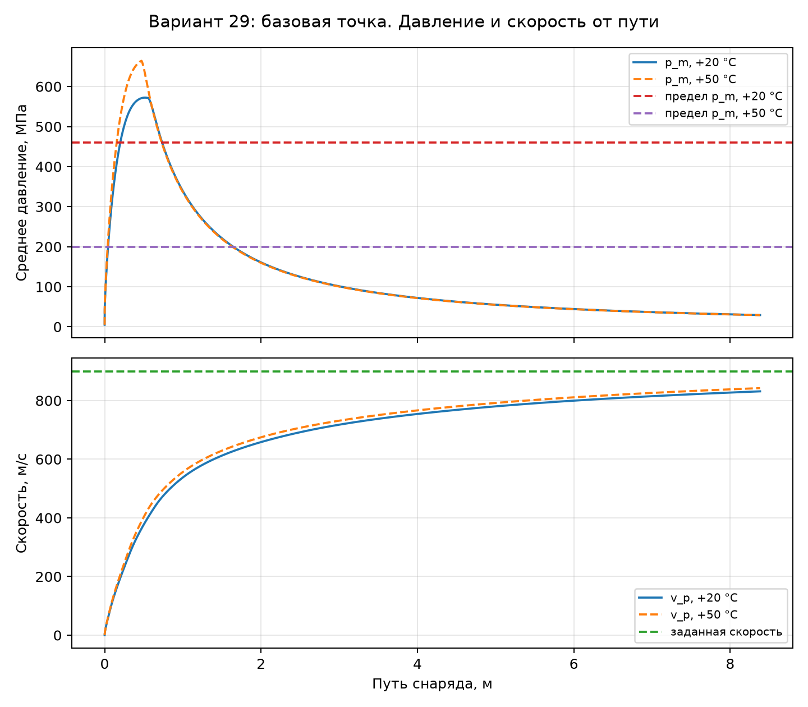
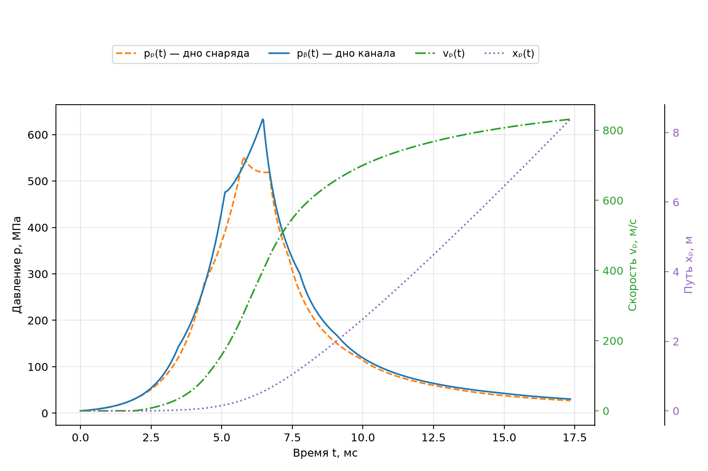
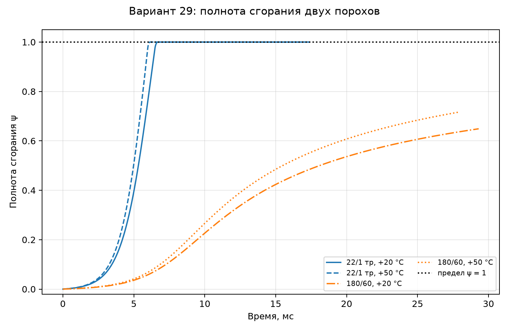

**МИНИСТЕРСТВО НАУКИ И ВЫСШЕГО ОБРАЗОВАНИЯ РОССИЙСКОЙ ФЕДЕРАЦИИ  
**Федеральное государственное автономное образовательное учреждение  
высшего образования  
«Московский государственный технический университет имени Н. Э.
Баумана  
(национальный исследовательский университет)»  
(МГТУ им. Н. Э. Баумана)

**ФАКУЛЬТЕТ «СПЕЦИАЛЬНОЕ МАШИНОСТРОЕНИЕ» (СМ)**

**КАФЕДРА «РАКЕТНЫЕ И ИМПУЛЬСНЫЕ СИСТЕМЫ» (СМ-6)**

**РАСЧЁТНО-ПОЯСНИТЕЛЬНАЯ ЗАПИСКА**

**ЛАБОРАТОРНАЯ РАБОТА № 1**

**по дисциплине «ИТ при проектировании РиСО»**

**на тему:**

**«Прямой баллистический расчёт варианта 29»**
Обезличенная работа LR1-022

(подпись, дата)

(подпись, дата)

Москва, 2026

# **СОДЕРЖАНИЕ**

Введение 3

1 Исходные данные, критерий и ограничения варианта 4

> 1.1 Исходные данные 4
>
> 1.2 Критерий варианта 5
>
> 1.3 Ограничения варианта 5
>
> 1.4 Замысел вычислительной проверки 6
>
> 1.5 Параметры квазиизмеренной модели 7

2 Методика расчёта и программная реализация 8

> 2.1 Нормирование нарушений 8
>
> 2.2 Штраф с гарантированным разделением области 8
>
> 2.3 Основания решения и реализации 9
>
> 2.4 Температурные режимы и воспроизводимость 10

3 Результаты вычислительного исследования 11

> 3.1 Результаты основного решения 11
>
> 3.2 Проверка физической и вычислительной согласованности 13
>
> 3.3 Проверка ограничений 14
>
> 3.4 Допустимое, недопустимое и нерассчитываемое решения 15
>
> 3.5 Границы интерпретации результатов 16

Заключение 17

Список использованных источников 17

Приложение А Текст программы 18

Оглавление формируется автоматически при сборке отчёта на основе единого
перечня разделов.

# **ВВЕДЕНИЕ**

Внутренняя баллистика рассматривает движение снаряда и изменение
параметров пороховых газов в канале ствола. Для расчётной практики
существенна не только величина дульной скорости, но и согласование
скорости с ограничениями по давлению, длине ствола и перегрузке. В
настоящей работе выполнен прямой расчёт варианта 29 в квазиизмеренной
постановке. Исходные ограничения приняты по методическим указаниям [1],
расчёт выполнен библиотекой pyballistics [2, 3], а оформление отчёта
выполнено с учётом ГОСТ 7.32-2017 [4].

Цель работы — разработать воспроизводимую программу прямого
баллистического расчёта для варианта 29, реализовать проверку критерия и
ограничений, а также исследовать поведение вычислительной процедуры на
рассчитываемых и ошибочных входных данных.

Для достижения цели решены следующие задачи: сформированы исходные
данные варианта; определены критерий и система ограничений; реализовано
извлечение временных рядов давления, скорости, пути и полноты сгорания;
введён нормированный штраф; проведены расчёты при температурах +20 и +50
°C; выполнены автоматические тесты граничных и ошибочных состояний.

Работа не подменяет прямой расчёт процедурой оптимизации. Выбранные
сценарии фиксированы, поэтому результаты могут быть повторены при
запуске программы с теми же входными данными и версией библиотеки.

# **1 Исходные данные, критерий и ограничения варианта**

## **1.1 Исходные данные**

Согласно заданию \[1\], исследуется нарезное орудие калибра 152,4 мм с
массой снаряда 54 кг. Требуемая дульная скорость составляет 900 м/с. При
расчёте учтены давление воспламенителя 5 МПа, давление форсирования 30
МПа и коэффициент 1,04, учитывающий влияние нарезов на площадь канала.

Таблица 1 — Исходные данные варианта 29

| **Параметр**       | **Обозначение** | **Значение** |
|--------------------|-----------------|--------------|
| Калибр             | d               | 152,4 мм     |
| Масса снаряда      | q               | 54 кг        |
| Требуемая скорость | vₚₘ             | 900 м/с      |
| Модель             | —               | КМ           |
| Температуры        | T               | +20; +50 °C  |

S = 1,04 · πd² / 4; lₘₐₓ = 55d = 8,382 м.

Для каждой исследуемой точки задаются относительная масса заряда ω/q и
плотность заряжания Δ. Масса заряда и начальный объём каморы
определяются соответственно как ω = q(ω/q) и W₀ = ω/Δ.

## **1.2 Критерий варианта**

Критерием варианта является объём канала ствола с каморой Wₚₘ. Он
характеризует геометрическую цену решения: при равных условиях меньший
объём предпочтителен. В расчёте критерий сохраняется отдельно от
штрафного значения, что исключает смешение физической величины и меры
нарушения ограничений.

$$W_{pm}=W_0+l_pS=\frac{\omega}{\Delta}+l_pS.$$ 

Здесь lₚ — путь снаряда в конечном слое прямого расчёта. Выражение
применимо только к точке, для которой решатель возвратил корректные
расчётные слои. При аварийном завершении критерию не приписывается
произвольное число.

## **1.3 Ограничения варианта**

Проверка ограничений проводится по двум температурным режимам.
Ограничение среднего давления при +50 °C является индивидуальным
ограничением варианта и имеет более жёсткое значение, чем общее
ограничение давления при +20 °C.

Таблица 2 — Система ограничений

| **Условие**             | **Предел**       | **Режим** |
|-------------------------|------------------|-----------|
| Среднее давление pₘ     | не более 460 МПа | +20 °C    |
| Длина пути lₚ           | не более 8,382 м | +20 °C    |
| Перегрузка gₚ           | не более 16000 g | +20 °C    |
| Среднее давление pₘ,+50 | не более 200 МПа | +50 °C    |
| Дульная скорость vₚₘ    | не менее 900 м/с | +20 °C    |

## **1.4 Замысел вычислительной проверки**

Для основного расчёта принята базовая точка с порохом «22/1 тр», ω/q =
0,180 и Δ = 700 кг/м³. Вторая точка использует порох «180/60» при тех же
геометрических параметрах. Третья точка содержит отсутствующую в
справочнике марку пороха и служит для проверки реакции программы на
невозможность расчёта.

Отдельно применён фиксированный прямой скрининг 102 марок пороха на
сетке из четырёх значений ω/q и четырёх значений Δ. Общее число расчётов
равно 102 × 4 × 4 = 1632. Это исследование не является оптимизацией и не
может доказывать отсутствие допустимой точки вне заданной области.

## **1.5 Параметры квазиизмеренной модели**

Квазиизмеренная модель заменяет полное пространственное описание течения
последовательностью расчётных слоёв. В каждом слое определяются
давление, координаты расчётной сетки, скорость и положение снаряда.
Такая постановка допускает различие давлений у дна канала и у дна
снаряда и вместе с тем сохраняет вычислительную экономичность,
необходимую для серии прямых расчётов.

Начальное давление воспламенителя задаёт запуск процесса горения, а
давление форсирования определяет момент начала движения снаряда. Их
введение особенно важно при анализе раннего участка процесса: пока
давление недостаточно, путь снаряда не изменяется, а после преодоления
форсирования возникает ускорение.

Полнота сгорания ψ является безразмерной величиной от нуля до единицы.
Значение ψ = 0 соответствует отсутствию сгоревшей части заряда, ψ = 1 —
завершению горения. В программе полнота извлекается из слоёв модели как
массово-взвешенное значение; это позволяет корректно сопоставлять
расчёты, имеющие разную внутреннюю сетку.

$$0\le\psi\le1,\qquad g_p=\frac{1}{g_0}\frac{dv_p}{dt}.$$ 

# **2 Методика расчёта и программная реализация**

## **2.1 Нормирование нарушений**

Для сопоставления нарушений разной физической размерности каждое
ограничение приводится к безразмерной относительной величине. Для
ограничения верхнего типа используется превышение над пределом, а для
условия по скорости — относительный недобор. Отрицательные значения
заменяются нулём: выполненное условие не вносит вклада в штраф.

rᵥ = (vₜᵣ - vₚₘ) / vₜᵣ; rₚ = (pₘ - pₗᵢₘ) / pₗᵢₘ; rₗ = (lₚ - lₗᵢₘ) /
lₗᵢₘ.

Вычисление среднего давления производится по дискретной ячеечной
формуле. Если давления pᵢ заданы в ячейках с координатами xᵢ, то
применяют взвешивание по длинам ячеек. Такая запись согласована с
сеточной природой квазиизмеренной модели и не заменяет среднее давление
значением на дне канала.

$$p_m=\frac{\sum_i\Delta x_i p_i}{x_n-x_0}.$$ 

## **2.2 Штраф с гарантированным разделением области**

Для рассчитываемых точек реализован внешний нормированный квадратичный
штраф. Его значение равно нулю тогда и только тогда, когда все
проверяемые ограничения выполнены. Поэтому допустимые точки сохраняют
исходный критерий, а недопустимые получают строго большее штрафное
значение.

$$P=\sum_i\left[\max(0,r_i)\right]^2,\qquad \widetilde W_{pm}=W_{pm}(1+P).$$

Выбор множителя (1 + P) сохраняет размерность критерия и гарантирует W̃ₚₘ
= Wₚₘ при P = 0. Если хотя бы одно ограничение нарушено, P &gt; 0 и W̃ₚₘ
&gt; Wₚₘ. Для статусов calculation\_error и invalid\_input значения Wₚₘ,
P и W̃ₚₘ не определяются; точка исключается из сравнения, а не
искусственно штрафуется.

## **2.3 Основания решения и реализации**

Программная реализация построена вокруг функции ozvb\_lagrange. Для
каждой корректной точки выполняются два независимых расчёта: при +20 и
+50 °C. Из слоёв извлекаются время t, скорость снаряда vₚ, путь xₚ,
давление у дна канала, давление у дна снаряда, среднее давление и
полнота сгорания ψ.

Скорость и путь контролируются непосредственно по временным массивам.
Максимальная перегрузка определяется конечной разностью скорости: gₚ,max
= max(Δv/Δt)/g₀, где g₀ = 9,80665 м/с². Входные данные проверяются до
обращения к решателю; затем различаются статусы admissible,
inadmissible, invalid\_input и calculation\_error.

В основной программе формируются три графика: давление и скорость от
пути; совмещённые зависимости давлений, скорости и пути от времени;
полнота сгорания двух порохов при двух температурах. Такой набор
позволяет проверить как механическое движение снаряда, так и ход
газообразования.

## **2.4 Температурные режимы и воспроизводимость**

Температура метательного заряда влияет на ход процесса и поэтому расчёт
выполняется в двух режимах: +20 °C и +50 °C. Базовый режим необходим для
проверки общего ограничения среднего давления и перегрузки. Режим +50 °C
предназначен для проверки индивидуального ограничения варианта pₘ,+50 ≤
200 МПа.

Воспроизводимость обеспечивается фиксированными параметрами сценариев,
явным указанием марок пороха и сохранением графиков в каталоге figures.
Все вычисления выполняются при одной версии pyballistics. Отдельный файл
direct\_screen.py реализует перебор с заранее заданными диапазонами и
записывает результаты в таблицу CSV, не изменяя логику основной
программы.

Набор модульных тестов отделён от расчётных сценариев. Он проверяет
функции валидации, расчёт длины, обработку давления, формирование штрафа
и статусы ошибок. Таким образом, изменения визуализации или состава
исследовательских точек не должны нарушать проверяемые инварианты
модели.

# **3 Результаты вычислительного исследования**

## **3.1 Результаты основного решения**

Результаты двух рассчитываемых точек приведены в таблице 3. Базовая
точка развивает большую скорость, но одновременно существенно превышает
ограничения по давлению и перегрузке. Точка с порохом «180/60»
удовлетворяет ограничениям по давлению, перегрузке и длине, однако не
обеспечивает требуемую скорость.

Таблица 3 — Результаты прямых расчётов

| **Точка** | **vₚₘ, м/с** | **pₘ,+20, МПа** | **pₘ,+50, МПа** | **gₚ,+20, g** | **Статус**   |
|-----------|--------------|-----------------|-----------------|---------------|--------------|
| 22/1 тр   | 831,384      | 572,206         | 664,154         | 19018         | inadmissible |
| 180/60    | 537,837      | 132,542         | 145,566         | 4539          | inadmissible |

У базовой точки Wₚₘ = 0,172902 м³, P = 5,486854 и W̃ₚₘ = 1,121588 м³. Для
второй точки Wₚₘ = 0,172902 м³, P = 0,161929 и W̃ₚₘ = 0,200899 м³.
Совпадение исходных объёмов объясняется одинаковыми значениями ω/q, Δ и
конечного пути.

Для проверки одновременного выполнения требований по давлению и скорости
на рисунке 1 показаны их зависимости от пути снаряда при двух температурах.

Рисунок 1 — Давление и скорость снаряда в зависимости от пути

На рисунке 1 максимумы среднего давления достигаются в начальной части
пути; при +20 °C пик составляет 572,206 МПа, а при +50 °C — 664,154 МПа.
Обе кривые превышают соответствующие пунктирные пределы. Скорость
монотонно возрастает, но к концу заданного пути остаётся ниже требуемых
900 м/с: получены 831,384 и 842,362 м/с. Следовательно, базовая точка
одновременно не удовлетворяет ограничениям по давлению и условию
достижения заданной скорости.

Для анализа временного хода разгона на рисунке 2 приведены давления у дна
канала и снаряда, скорость и путь снаряда.

Рисунок 2 — Давления, скорость и путь снаряда в зависимости от времени

На рисунке 2 показан ход процесса во времени для базовой точки при +20
°C. Давление у дна канала достигает максимума раньше и остаётся выше
давления у дна снаряда, поэтому перепад давлений сообщает снаряду
ускорение. Скорость и путь возрастают монотонно; к моменту 17,344 мс
снаряд проходит 8,382 м. Спад давлений после пика соответствует
увеличению объёма за снарядом и завершению активной фазы разгона.

Для сопоставления кинетики двух порохов и влияния температуры на рисунке 3
приведена полнота сгорания во времени.

Рисунок 3 — Полнота сгорания порохов в зависимости от времени

Рисунок 3 показывает, что порох «22/1 тр» достигает полной степени
сгорания ψ = 1 примерно за 6–7 мс; при +50 °C этот момент наступает
несколько раньше. У пороха «180/60» горение существенно медленнее: к
окончанию расчёта ψ составляет 0,649 при +20 °C и 0,717 при +50 °C.
Температурное повышение ускоряет горение обоих порохов, однако характер
кинетики определяется также их маркой.

## **3.2 Проверка физической и вычислительной согласованности**

На рисунке 1 среднее давление и скорость представлены как функции пути
снаряда. Горизонтальные линии показывают пределы среднего давления и
требуемую скорость. Таким образом, нарушение видно не только в итоговой
таблице, но и на всём протяжении движения.

На рисунке 2 давление у дна канала выше давления у дна снаряда на
характерном участке разгона. Это согласуется с необходимостью
положительного перепада давления, сообщающего снаряду ускорение. Путь
является монотонно возрастающей функцией времени, а скорость возрастает
на активном участке процесса. Для базовой точки конечное время при +20
°C составляет 17,344 мс, конечный путь — 8,382 м.

Рисунок 3 демонстрирует различие в полноте сгорания. Для пороха «22/1
тр» полнота сгорания к завершению расчёта достигает ψ = 1. Для «180/60»
получены ψ = 0,649 при +20 °C и ψ = 0,717 при +50 °C. Пунктир ψ = 1
является физической границей полноты сгорания.

## **3.3 Проверка ограничений**

Проверка ограничений выполняется программой независимо для каждого
условия. В таблице 4 показана логическая сводка. Такой способ исключает
ситуацию, при которой одно большое нарушение маскирует несколько других
в единственном числе или в единственном графике.

Таблица 4 — Проверка ограничений

| **Условие**      | **22/1 тр** | **180/60** |
|------------------|-------------|------------|
| vₚₘ ≥ 900 м/с    | нет         | нет        |
| $l_p\le 8{,}382$ м | да          | да         |
| pₘ,+20 ≤ 460 МПа | нет         | да         |
| gₚ,+20 ≤ 16000 g | нет         | да         |
| pₘ,+50 ≤ 200 МПа | нет         | да         |

Автоматические тесты покрывают нулевые, отрицательные, граничные, очень
большие, бесконечные и неопределённые параметры, а также дискретную
формулу среднего давления и разделение статусов. Выполнено 139 тестов,
все завершились успешно. Это подтверждает вычислительную устойчивость
проверок, но не заменяет физическую валидацию самой модели.

## **3.4 Допустимое, недопустимое и нерассчитываемое решения**

Недопустимые решения представлены обеими рассчитываемыми точками.
Нерассчитываемое решение представлено третьей точкой с несуществующей
маркой пороха: библиотека возвращает KeyError: layers, программа
присваивает calculation\_error и явно фиксирует, что критерий и штраф не
определены.

Статус admissible реализован в коде и присваивается только при
одновременном выполнении всех пяти условий. Однако среди 1632 точек
фиксированного скрининга допустимая баллистическая точка не обнаружена.
Ближайший результат для пороха «НДТ-3 32/1» при ω/q = 0,70 и Δ = 300
кг/м³ имеет vₚₘ = 847,686 м/с и pₘ,+50 = 201,961 МПа. Следовательно, в
исследованной области не удалось одновременно выполнить требование по
скорости и индивидуальное ограничение по давлению при +50 °C.

Этот результат следует трактовать как отрицательный результат конечной
области перебора, а не как доказательство отсутствия допустимого решения
во всём непрерывном пространстве параметров. В отчёте намеренно не
вводится фиктивный допустимый пример.

## **3.5 Границы интерпретации результатов**

Результаты прямого расчёта следует интерпретировать в рамках принятых
исходных данных, модели и конечной сетки исследовательских точек.
Отрицательный результат перебора означает отсутствие допустимой точки
среди 1632 рассмотренных комбинаций, но не исключает существование
решения между узлами сетки или при иной совокупности конструктивных
параметров.

В частности, сравнение ближайшей точки скрининга показывает, что
дальнейшее увеличение энергии для достижения 900 м/с может быть
ограничено ростом среднего давления при +50 °C. Это наблюдение является
основанием для дальнейшего исследования, но не является изменением
ограничения и не допускает его ослабления.

Для последующего этапа целесообразно расширить диапазон марок пороха и
параметров заряжания, сохранив воспроизводимый план расчёта. Любое
полученное допустимое решение должно быть подтверждено повторным прямым
расчётом в обоих температурных режимах и проверкой всех ограничений, а
не только малым значением штрафного критерия.

# **ЗАКЛЮЧЕНИЕ**

Разработана программа прямого баллистического расчёта варианта 29 в
квазиизмеренной модели. В ней реализованы критерий Wₚₘ, система
ограничений, нормированный квадратичный штраф и раздельная обработка
статусов рассчитываемых, недопустимых и ошибочных точек.

Получены и интерпретированы три графика: зависимости давления и скорости
от пути, давления, скорости и пути от времени, а также полноты сгорания
двух порохов от времени. Автоматический набор из 139 тестов выполнен
успешно. Фиксированный расширенный скрининг из 1632 расчётов не выявил
допустимой точки при сохранении обязательного ограничения pₘ,+50 ≤ 200
МПа. Для получения допустимого решения требуется последующее расширение
области исследования или уточнение исходных предпосылок при сохранении
ограничений задания.

# **СПИСОК ИСПОЛЬЗОВАННЫХ ИСТОЧНИКОВ**

1\. Методические указания по выполнению курсовой работы по баллистике.
Таблица 4.1. Электронный учебный материал кафедры СМ-6 МГТУ им. Н. Э.
Баумана, PDF-файл (дата обращения: 27.09.2026).

2\. pyballistics 1.2.1. Документация пакета. Электронный ресурс. URL:
https://pypi.org/project/pyballistics/1.2.1/ (дата обращения:
27.09.2026).

3\. TovarnovM. pyballistics: библиотека для решения задач внутренней
баллистики. Электронный ресурс. URL:
https://github.com/TovarnovM/pyballistics (дата обращения: 27.09.2026).

4\. ГОСТ 7.32-2017. Отчёт о научно-исследовательской работе. Структура и
правила оформления. Москва: Стандартинформ, 2017. Электронный ресурс.
URL: https://protect.gost.ru/ (дата обращения: 27.09.2026).

# **ПРИЛОЖЕНИЕ А**

(обязательное)

**ТЕКСТ ОСНОВНОЙ ПРОГРАММЫ**

В приложении приведён полный текст файла main.py. Он выполняет прямой
баллистический расчёт, формирует три графика и выводит результаты
проверки ограничений.

> """Прямой баллистический расчёт: вариант 29.
>
> Запуск:
>
> uv sync
>
> uv run python main.py
>
> Скрипт не ищет оптимум. Он рассчитывает заранее заданные решения,
> проверяет
>
> ограничения варианта и сохраняет требуемые графики в \`\`figures/\`\`.
>
> """
>
> from \_\_future\_\_ import annotations
>
> from dataclasses import dataclass
>
> from importlib.metadata import version
>
> from pathlib import Path
>
> from typing import Any
>
> import matplotlib.pyplot as plt
>
> import numpy as np
>
> from pyballistics import ozvb\_lagrange
>
> ROOT = Path(\_\_file\_\_).resolve().parent
>
> FIGURES = ROOT / "figures"
>
> @dataclass(frozen=True)
>
> class Variant29:
>
> """Исходные данные и ограничения из табл. 4.1 методички."""
>
> d: float = 152.4e-3 \# м
>
> q: float = 54.0 \# кг
>
> target\_velocity: float = 900.0 \# м/с
>
> p\_mean\_limit: float = 460e6 \# Па, при +20 °C
>
> barrel\_calibers\_limit: float = 55.0
>
> acceleration\_limit\_g: float = 16\_000.0 \# при +20 °C
>
> p\_50\_limit: float = 200e6 \# Па, при +50 °C
>
> p\_ign\_0: float = 5e6 \# Па
>
> forcing\_pressure: float = 30e6 \# Па, нарезное орудие
>
> bore\_area\_factor: float = 1.04 \# для учёта нарезов
>
> @property
>
> def barrel\_length\_limit(self) -&gt; float:
>
> return self.barrel\_calibers\_limit \* self.d
>
> @property
>
> def bore\_area(self) -&gt; float:
>
> return self.bore\_area\_factor \* np.pi \* self.d\*\*2 / 4
>
> VARIANT = Variant29()
>
> @dataclass(frozen=True)
>
> class Solution:
>
> """Параметры одного исследуемого баллистического решения."""
>
> name: str
>
> powder: str
>
> omega\_over\_q: float \# относительная масса метательного заряда ω/q
>
> loading\_density: float \# кг/м³
>
> @property
>
> def omega(self) -&gt; float:
>
> return self.omega\_over\_q \* VARIANT.q
>
> @property
>
> def chamber\_volume(self) -&gt; float:
>
> return self.omega / self.loading\_density
>
> @dataclass(frozen=True)
>
> class Series:
>
> """Временные ряды, извлечённые из результата квазиизмеренной
> модели."""
>
> t: np.ndarray
>
> velocity: np.ndarray
>
> travel: np.ndarray
>
> mean\_pressure: np.ndarray
>
> breech\_pressure: np.ndarray
>
> projectile\_base\_pressure: np.ndarray
>
> burned\_fraction: np.ndarray
>
> @property
>
> def peak\_mean\_pressure(self) -&gt; float:
>
> return float(self.mean\_pressure.max())
>
> @property
>
> def max\_acceleration\_g(self) -&gt; float:
>
> dt = np.diff(self.t)
>
> if np.any(dt &lt;= 0):
>
> raise ValueError("Временная сетка должна строго возрастать")
>
> return float(np.max(np.diff(self.velocity) / dt) / 9.80665)
>
> \# Эти точки намеренно не являются результатом оптимизации: они нужны
> для
>
> \# воспроизводимой проверки допустимого и недопустимого сценариев.
>
> STUDY\_SOLUTIONS = (
>
> Solution("базовая точка", "22/1 тр", 0.18, 700.0),
>
> Solution("сравнительный порох 180/60", "180/60", 0.18, 700.0),
>
> Solution("ошибочная марка пороха", "НЕСУЩЕСТВУЮЩАЯ\_МАРКА", 0.20,
> 700.0),
>
> )
>
> def validate\_solution(solution: Solution) -&gt; str \| None:
>
> """Проверить входные параметры до вызова дорогой численной модели.
>
> Физически бессмысленные, бесконечные и неопределённые значения не
> должны
>
> попадать в \`\`pyballistics\`\`: это сохраняет вычислительный бюджет и
> даёт
>
> однозначный статус вместо неинформативной ошибки решателя.
>
> """
>
> if not solution.name.strip():
>
> return "Название исследуемой точки не задано"
>
> if not solution.powder.strip():
>
> return "Марка пороха не задана"
>
> values = {
>
> "относительная масса заряда ω/q": solution.omega\_over\_q,
>
> "плотность заряжания Δ": solution.loading\_density,
>
> }
>
> for label, value in values.items():
>
> if not np.isfinite(value):
>
> return f"{label} должно быть конечным числом"
>
> if value &lt;= 0:
>
> return f"{label} должно быть больше нуля"
>
> if not np.isfinite(solution.chamber\_volume) or
> solution.chamber\_volume &lt;= 0:
>
> return "Объём каморы должен быть конечным и положительным"
>
> return None
>
> def make\_options(solution: Solution, temperature\_c: float,
> stop\_conditions: dict\[str, float\]) -&gt; dict\[str, Any\]:
>
> """Собрать входной словарь для квазиизмеренной модели pyballistics."""
>
> return {
>
> "powders": \[{"omega": solution.omega, "dbname": solution.powder}\],
>
> "init\_conditions": {
>
> "q": VARIANT.q,
>
> "d": VARIANT.d,
>
> "W\_0": solution.chamber\_volume,
>
> "phi\_1": VARIANT.bore\_area\_factor,
>
> "p\_0": VARIANT.forcing\_pressure,
>
> "n\_S": VARIANT.bore\_area\_factor,
>
> "T\_0": 273.15 + temperature\_c,
>
> },
>
> "igniter": {"p\_ign\_0": VARIANT.p\_ign\_0},
>
> "meta\_lagrange": {"n\_cells": 300, "CFL": 0.9},
>
> "stop\_conditions": {\*\*stop\_conditions, "steps\_max": 100\_000},
>
> }
>
> def layer\_series(raw: dict\[str, Any\]) -&gt; Series:
>
> """Извлечь из результата КМ временные ряды у дна снаряда."""
>
> layers = raw\["layers"\]
>
> t = np.asarray(\[layer\["t"\] for layer in layers\], dtype=float)
>
> velocity = np.asarray(\[layer\["u"\]\[-1\] for layer in layers\],
> dtype=float)
>
> travel = np.asarray(\[layer\["x"\]\[-1\] for layer in layers\],
> dtype=float)
>
> mean\_pressure = \[\]
>
> breech\_pressure = \[\]
>
> projectile\_base\_pressure = \[\]
>
> burned\_fraction = \[\]
>
> for layer in layers:
>
> x = np.asarray(layer\["x"\], dtype=float)
>
> p = np.asarray(layer\["p"\], dtype=float)
>
> psi = np.asarray(layer\["psi\_1"\], dtype=float)
>
> if len(p) != len(x) - 1:
>
> raise ValueError("Размеры сетки x и давления p несовместимы")
>
> if len(psi) != len(p):
>
> raise ValueError("Размеры сетки psi\_1 и давления p несовместимы")
>
> dx = np.diff(x)
>
> if len(dx) &lt; 1 or x\[-1\] &lt;= x\[0\] or np.any(dx &lt;= 0):
>
> raise ValueError("Недостаточная пространственная сетка для среднего
> давления")
>
> \# p\[i\] задано в i-й ячейке сетки \[x\[i\], x\[i + 1\]\]. Именно
> такая
>
> \# дискретная формула p\_m = Σ(Δx\_i p\_i)/(x\_n - x\_0) использована
> в
>
> \# консультационном примере для квазиизмеренной модели.
>
> mean\_pressure.append(np.sum(dx \* p) / (x\[-1\] - x\[0\]))
>
> \# Давление в первой ячейке соответствует дну канала, в последней —
>
> \# дну снаряда. Эти ряды используются для графика p(t).
>
> breech\_pressure.append(p\[0\])
>
> projectile\_base\_pressure.append(p\[-1\])
>
> \# psi\_1 — полнота сгорания пороха в ячейках КМ. Для одного
>
> \# временного момента её представительное значение — среднее по
>
> \# объёму канала; небольшое численное превышение 1 ограничивается.
>
> burned\_fraction.append(np.clip(np.sum(dx \* psi) / (x\[-1\] -
> x\[0\]), 0.0, 1.0))
>
> return Series(
>
> t=t,
>
> velocity=velocity,
>
> travel=travel,
>
> mean\_pressure=np.asarray(mean\_pressure),
>
> breech\_pressure=np.asarray(breech\_pressure),
>
> projectile\_base\_pressure=np.asarray(projectile\_base\_pressure),
>
> burned\_fraction=np.asarray(burned\_fraction),
>
> )
>
> def quadratic\_penalty(
>
> \*,
>
> velocity: float,
>
> length: float,
>
> p20: float,
>
> acceleration\_g: float,
>
> p50: float,
>
> ) -&gt; float:
>
> """Безразмерный внешний квадратичный штраф для минимизации W\_pm.
>
> Нулевой штраф соответствует допустимой точке. Каждый член — квадрат
>
> относительного нарушения своего ограничения; исходный W\_pm не
> меняется.
>
> """
>
> violations = (
>
> max(0.0, (VARIANT.target\_velocity - velocity) /
> VARIANT.target\_velocity),
>
> max(0.0, (length - VARIANT.barrel\_length\_limit) /
> VARIANT.barrel\_length\_limit),
>
> max(0.0, (p20 - VARIANT.p\_mean\_limit) / VARIANT.p\_mean\_limit),
>
> max(0.0, (acceleration\_g - VARIANT.acceleration\_limit\_g) /
> VARIANT.acceleration\_limit\_g),
>
> max(0.0, (p50 - VARIANT.p\_50\_limit) / VARIANT.p\_50\_limit),
>
> )
>
> return float(sum(value\*\*2 for value in violations))
>
> def evaluate(solution: Solution) -&gt; dict\[str, Any\]:
>
> """Рассчитать при +20/+50 °C и проверить все ограничения варианта
> 29."""
>
> result: dict\[str, Any\] = {"solution": solution, "status": "ok",
> "violations": \[\]}
>
> input\_error = validate\_solution(solution)
>
> if input\_error:
>
> result.update(
>
> status="invalid\_input", error=input\_error, w\_pm=None, penalty=None,
>
> penalized\_w\_pm=None, explanation="Критерий и штрафное значение не
> определены: точка исключена до расчёта.",
>
> )
>
> return result
>
> try:
>
> raw20 = ozvb\_lagrange(
>
> make\_options(
>
> solution,
>
> 20.0,
>
> {"v\_p": VARIANT.target\_velocity, "x\_p":
> VARIANT.barrel\_length\_limit},
>
> )
>
> )
>
> data20 = layer\_series(raw20)
>
> raw50 = ozvb\_lagrange(make\_options(solution, 50.0, {"x\_p":
> data20.travel\[-1\]}))
>
> data50 = layer\_series(raw50)
>
> except Exception as exc: \# библиотека сообщает нерассчитываемую точку
> исключением
>
> result.update(
>
> status="calculation\_error", error=f"{type(exc).\_\_name\_\_}: {exc}",
> w\_pm=None,
>
> penalty=None, penalized\_w\_pm=None,
>
> explanation="Критерий и штрафное значение не определены: прямой расчёт
> не получен, точка исключена.",
>
> )
>
> return result
>
> \# Критерий W\_pm: объём каморы плюс объём пройденной снарядом части
> канала.
>
> \# Это исходный критерий. Он хранится отдельно от штрафного значения.
>
> barrel\_length = float(data20.travel\[-1\])
>
> muzzle\_velocity = float(data20.velocity\[-1\])
>
> w\_pm = solution.chamber\_volume + barrel\_length \*
> VARIANT.bore\_area
>
> acceleration\_g = data20.max\_acceleration\_g
>
> p20 = data20.peak\_mean\_pressure
>
> p50 = data50.peak\_mean\_pressure
>
> checks = {
>
> "достижение v\_pm": raw20.get("stop\_reason") == "v\_p",
>
> "длина ствола": barrel\_length &lt;= VARIANT.barrel\_length\_limit,
>
> "p\_m(+20 °C)": p20 &lt;= VARIANT.p\_mean\_limit,
>
> "g\_p(+20 °C)": acceleration\_g &lt;= VARIANT.acceleration\_limit\_g,
>
> "p\_m(+50 °C)": p50 &lt;= VARIANT.p\_50\_limit,
>
> }
>
> penalty = quadratic\_penalty(
>
> velocity=muzzle\_velocity,
>
> length=barrel\_length,
>
> p20=p20,
>
> acceleration\_g=acceleration\_g,
>
> p50=p50,
>
> )
>
> result.update(
>
> raw20=raw20,
>
> raw50=raw50,
>
> data20=data20,
>
> data50=data50,
>
> w\_pm=w\_pm,
>
> penalized\_w\_pm=w\_pm \* (1.0 + penalty),
>
> penalty=penalty,
>
> acceleration\_g=acceleration\_g,
>
> muzzle\_velocity=muzzle\_velocity,
>
> barrel\_length=barrel\_length,
>
> p20=p20,
>
> p50=p50,
>
> checks=checks,
>
> )
>
> result\["violations"\] = \[name for name, passed in checks.items() if
> not passed\]
>
> result\["status"\] = "admissible" if not result\["violations"\] else
> "inadmissible"
>
> return result
>
> def \_save\_figure(fig: plt.Figure, filename: str) -&gt; Path:
>
> """Сохранить рисунок в каталоге проекта и освободить ресурсы
> matplotlib."""
>
> FIGURES.mkdir(exist\_ok=True)
>
> target = FIGURES / filename
>
> fig.tight\_layout()
>
> fig.savefig(target, dpi=180)
>
> plt.close(fig)
>
> return target
>
> def plot(result: dict\[str, Any\]) -&gt; list\[Path\]:
>
> """Построить два кинематико-баллистических графика базовой точки.
>
> Создаются отдельные рисунки: давление и скорость от пути; давление,
>
> скорость и путь от времени. Линии ограничений показываются пунктиром.
>
> Для нерассчитываемого входа список рисунков пуст.
>
> """
>
> if result\["status"\] in {"calculation\_error", "invalid\_input"}:
>
> return \[\]
>
> data20, data50 = result\["data20"\], result\["data50"\]
>
> solution: Solution = result\["solution"\]
>
> t20, t50 = data20.t \* 1e3, data50.t \* 1e3
>
> \# 1. Давление и скорость снаряда в зависимости от пути.
>
> fig\_path, (ax\_p\_path, ax\_v\_path) = plt.subplots(2, 1, figsize=(8,
> 7), sharex=True)
>
> ax\_p\_path.plot(data20.travel, data20.mean\_pressure / 1e6,
> label="p\_m, +20 °C")
>
> ax\_p\_path.plot(data50.travel, data50.mean\_pressure / 1e6,
> label="p\_m, +50 °C")
>
> ax\_p\_path.axhline(VARIANT.p\_mean\_limit / 1e6, color="tab:red",
> ls="--", label="предел p\_m, +20 °C")
>
> ax\_p\_path.axhline(VARIANT.p\_50\_limit / 1e6, color="tab:purple",
> ls="--", label="предел p\_m, +50 °C")
>
> ax\_p\_path.set\_ylabel("Среднее давление, МПа")
>
> ax\_p\_path.grid(True, alpha=0.3)
>
> ax\_p\_path.legend(fontsize=8)
>
> ax\_v\_path.plot(data20.travel, data20.velocity, label="v\_p, +20 °C")
>
> ax\_v\_path.plot(data50.travel, data50.velocity, label="v\_p, +50 °C")
>
> ax\_v\_path.axhline(VARIANT.target\_velocity, color="tab:green",
> ls="--", label="заданная скорость")
>
> ax\_v\_path.set\_xlabel("Путь снаряда, м")
>
> ax\_v\_path.set\_ylabel("Скорость, м/с")
>
> ax\_v\_path.grid(True, alpha=0.3)
>
> ax\_v\_path.legend(fontsize=8)
>
> fig\_path.suptitle(f"Вариант 29: {solution.name}. Давление и скорость
> от пути")
>
> \# 2. Все требуемые зависимости от времени на одном поле, как в
> образце:
>
> \# два давления — слева, скорость и путь — на двух правых шкалах.
>
> fig\_time, ax\_p = plt.subplots(figsize=(9, 6))
>
> ax\_v = ax\_p.twinx()
>
> ax\_x = ax\_p.twinx()
>
> ax\_x.spines.right.set\_position(("axes", 1.13))
>
> line\_p\_projectile, = ax\_p.plot(
>
> t20, data20.projectile\_base\_pressure / 1e6,
>
> color="tab:orange", ls="--", label="pₚ(t) — дно снаряда",
>
> )
>
> line\_p\_breech, = ax\_p.plot(
>
> t20, data20.breech\_pressure / 1e6,
>
> color="tab:blue", label="pᵦ(t) — дно канала",
>
> )
>
> line\_v, = ax\_v.plot(t20, data20.velocity, color="tab:green",
> ls="-.", label="vₚ(t)")
>
> line\_x, = ax\_x.plot(t20, data20.travel, color="tab:purple", ls=":",
> label="xₚ(t)")
>
> ax\_p.set\_xlabel("Время t, мс")
>
> ax\_p.set\_ylabel("Давление p, МПа")
>
> ax\_v.set\_ylabel("Скорость vₚ, м/с", color="tab:green")
>
> ax\_x.set\_ylabel("Путь xₚ, м", color="tab:purple")
>
> ax\_v.tick\_params(axis="y", colors="tab:green")
>
> ax\_x.tick\_params(axis="y", colors="tab:purple")
>
> ax\_p.grid(True, alpha=0.3)
>
> ax\_p.legend(
>
> \[line\_p\_projectile, line\_p\_breech, line\_v, line\_x\],
>
> \[line.get\_label() for line in (line\_p\_projectile, line\_p\_breech,
> line\_v, line\_x)\],
>
> loc="upper center", bbox\_to\_anchor=(0.5, 1.20), ncols=4, fontsize=9,
>
> )
>
> fig\_time.suptitle(f"Вариант 29: {solution.name}. Параметры от времени
> (+20 °C)", y=1.06)
>
> stem = solution.name.replace(" ", "\_")
>
> return \[
>
> \_save\_figure(fig\_path,
> f"{stem}\_давление\_и\_скорость\_от\_пути.png"),
>
> \_save\_figure(fig\_time,
> f"{stem}\_давление\_скорость\_путь\_от\_времени.png"),
>
> \]
>
> def plot\_burn\_comparison(results: list\[dict\[str, Any\]\]) -&gt;
> Path \| None:
>
> """Построить ψ(t) для двух марок пороха при +20 и +50 °C.
>
> На одном графике показаны четыре кривые: две марки пороха, каждая при
>
> двух температурах. Пунктир ψ=1 — физический предел полноты сгорания.
>
> """
>
> calculable = \[item for item in results if item\["status"\] not in
> {"calculation\_error", "invalid\_input"}\]
>
> if len(calculable) &lt; 2:
>
> return None
>
> fig, ax = plt.subplots(figsize=(8, 5.2))
>
> colors = ("tab:blue", "tab:orange")
>
> for color, item in zip(colors, calculable\[:2\]):
>
> solution: Solution = item\["solution"\]
>
> label = solution.powder
>
> data20, data50 = item\["data20"\], item\["data50"\]
>
> ax.plot(data20.t \* 1e3, data20.burned\_fraction, color=color,
> label=f"{label}, +20 °C")
>
> ax.plot(data50.t \* 1e3, data50.burned\_fraction, color=color,
> ls="--", label=f"{label}, +50 °C")
>
> ax.axhline(1.0, color="black", ls=":", label="предел ψ = 1")
>
> ax.set\_xlabel("Время, мс")
>
> ax.set\_ylabel("Полнота сгорания ψ")
>
> ax.set\_ylim(-0.02, 1.05)
>
> ax.grid(True, alpha=0.3)
>
> ax.legend(fontsize=8, ncols=2)
>
> fig.suptitle("Вариант 29: полнота сгорания двух порохов")
>
> return \_save\_figure(fig,
> "полнота\_сгорания\_двух\_порохов\_от\_времени.png")
>
> def print\_summary(result: dict\[str, Any\]) -&gt; None:
>
> solution: Solution = result\["solution"\]
>
> print(f"\\n{solution.name}: powder={solution.powder},
> ω/q={solution.omega\_over\_q:.3f}, Δ={solution.loading\_density:.0f}
> кг/м³")
>
> print(f"status={result\['status'\]}")
>
> if result\["status"\] in {"calculation\_error", "invalid\_input"}:
>
> print(result\["error"\])
>
> print(result\["explanation"\])
>
> return
>
> print(
>
> f"W\_pm={result\['w\_pm'\]:.6f} м³; штраф={result\['penalty'\]:.3f}; "
>
> f"W\_pm,штр={result\['penalized\_w\_pm'\]:.6f} м³;
> g\_p(+20)={result\['acceleration\_g'\]:.0f} g"
>
> )
>
> for name, passed in result\["checks"\].items():
>
> print(f" {name}: {'OK' if passed else 'НАРУШЕНО'}")
>
> def main() -&gt; None:
>
> print(f"pyballistics={version('pyballistics')}")
>
> print("Вариант 29: d=152.4 мм, q=54 кг, v\_pm=900 м/с, нарезное
> орудие, КМ, min W\_pm")
>
> results = \[\]
>
> for solution in STUDY\_SOLUTIONS:
>
> result = evaluate(solution)
>
> results.append(result)
>
> print\_summary(result)
>
> if solution.name == "базовая точка":
>
> for path in plot(result):
>
> print(f"created={path.relative\_to(ROOT)}")
>
> burn\_path = plot\_burn\_comparison(results)
>
> if burn\_path:
>
> print(f"created={burn\_path.relative\_to(ROOT)}")
>
> if \_\_name\_\_ == "\_\_main\_\_":
>
> main()
