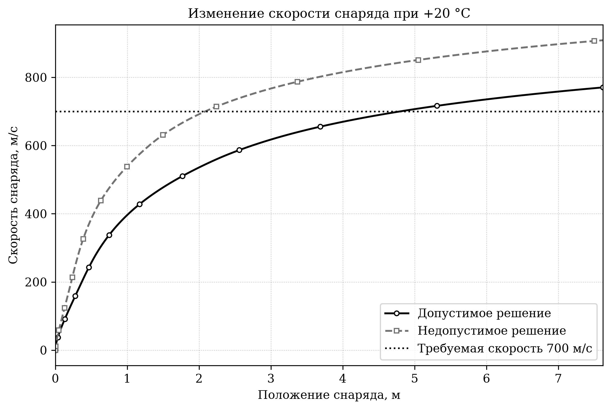
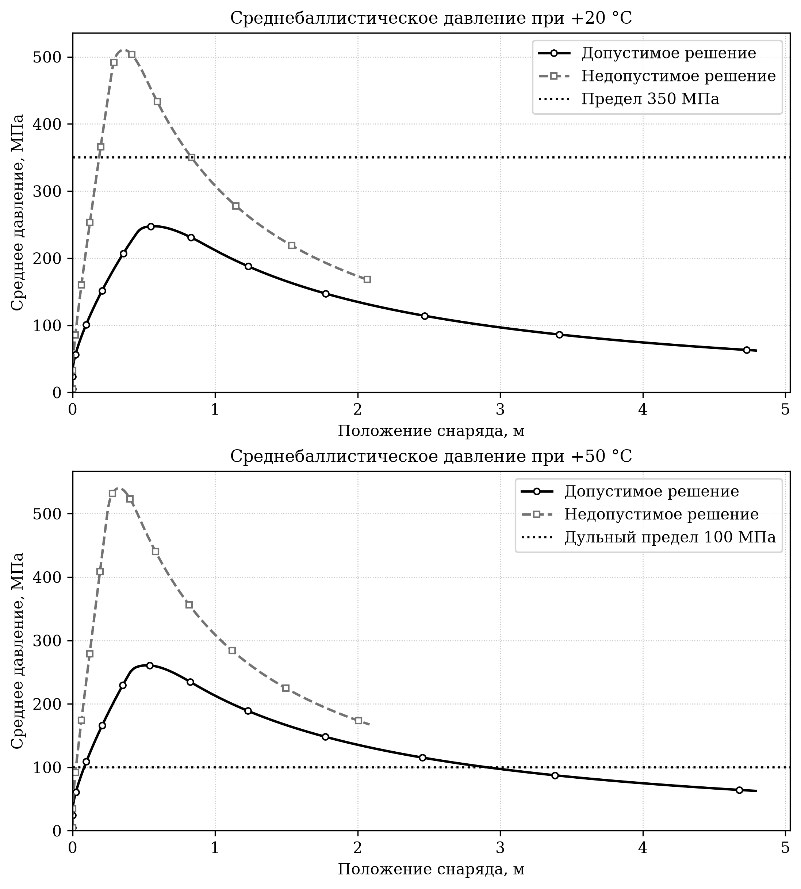
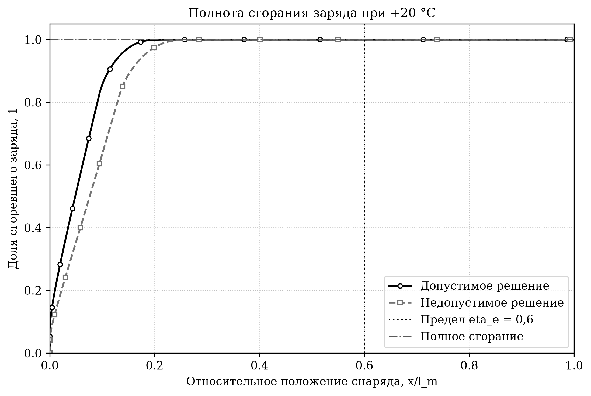
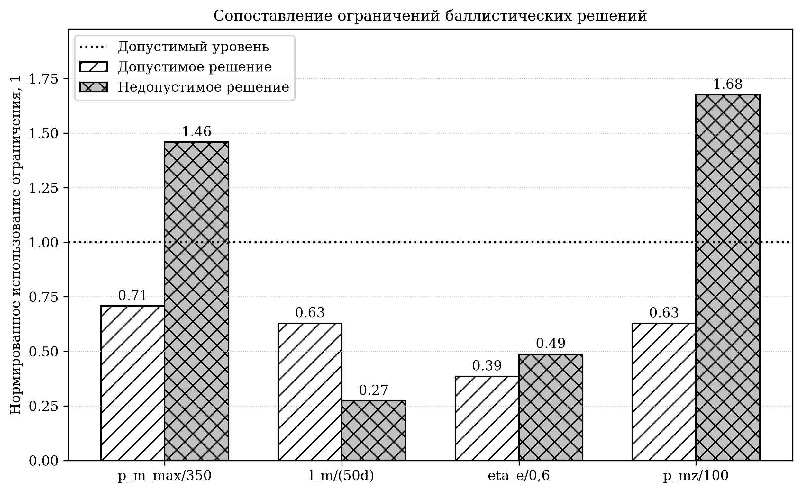
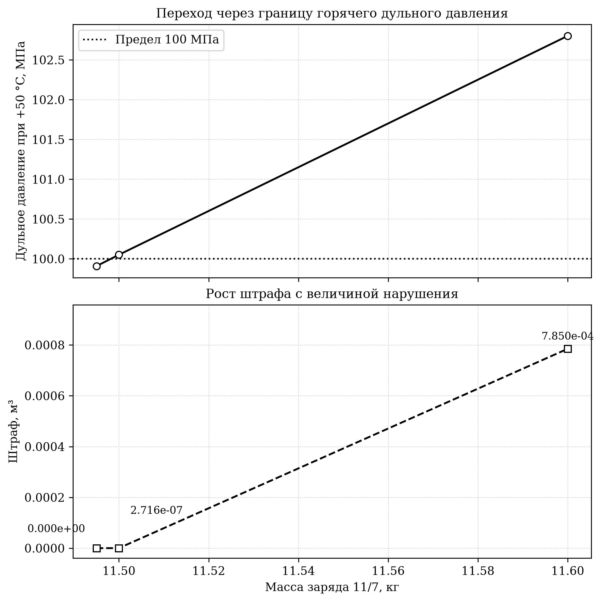

<div class="title-page">
<div class="title-top">
Министерство науки и высшего образования Российской Федерации<br>
Федеральное государственное автономное образовательное учреждение<br>
высшего образования<br>
«Московский государственный технический университет<br>
имени Н. Э. Баумана<br>
(национальный исследовательский университет)»<br><br>
Кафедра СМ-6 «Ракетные и импульсные системы»
</div>

<div class="title-center">
<strong>ЛАБОРАТОРНАЯ РАБОТА № 1</strong><br><br>
по дисциплине<br>
«Внутренняя баллистика ствольных систем»<br><br>
<strong>«Markdown, LaTeX и воспроизводимый отчёт<br>
по прямому баллистическому расчёту»</strong>
</div>

<div class="title-signatures">
<div>Студент: Барышев Савва</div>
<div>Группа: СМ6-72</div>
<div>Преподаватель: Товарнов М.С.</div>
</div>

<div class="title-bottom">
Москва<br>
2026
</div>
</div>

# ВВЕДЕНИЕ {.structural}

Цель работы — реализовать воспроизводимый прямой расчёт внутренней
баллистики для варианта № 17, проверить вычисление критерия и всех
ограничений, исследовать действие штрафной функции на допустимом и
недопустимом решениях и подтвердить контролируемую обработку ошибки модели.
Физические определения и параметры варианта приняты по
учебно-методическому пособию [1], а расчёт выполняется квазиодномерной
моделью `ozvb_lagrange` библиотеки `pyballistics` версии 1.2.1 [2]. Отчёт
оформлен по сокращённому профилю ГОСТ 7.32-2017 [3].

Для проверки выбраны шесть точек: основное допустимое и недопустимое решения,
нерассчитываемая точка с неизвестной маркой пороха, близкая пара по разные
стороны границы горячего дульного давления и точка с увеличенным нарушением
этой границы. Такой набор позволяет раздельно проверить численный статус,
допустимость, чистый критерий и штраф, а также подтвердить рост штрафа с
величиной рассчитанного нарушения. Изменение скорости,
среднебаллистического давления, полноты сгорания и штрафа представлено
графически.

# 1 ИСХОДНЫЕ ДАННЫЕ И КРИТЕРИЙ

## 1.1 Параметры варианта

Рассматривается нарезное орудие калибра $d=152{,}4$ мм с массой снаряда
$q=43{,}56$ кг. Требуемая дульная скорость равна $v_{pm}=700$ м/с. Для
нарезного орудия площадь канала ствола определяется по формуле (1).

<div class="equation-row">
<div class="equation-math">

$$
S=0{,}26\pi d^2=0{,}018971128017\ \text{м}^2.
$$

</div>
<div class="equation-number">(1)</div>
</div>

где $S$ — площадь поперечного сечения канала ствола, м²; $d$ — калибр
орудия, м.

Основные постоянные расчёта приведены в таблице 1. Температуры $+20$ °C и
$+50$ °C заданы как 293,15 К и 323,15 К соответственно.

<p class="table-title">Таблица 1 — Исходные данные варианта № 17</p>

| Величина | Обозначение | Значение |
|---|---:|---:|
| Калибр | $d$ | 0,1524 м |
| Масса снаряда | $q$ | 43,56 кг |
| Требуемая скорость | $v_{pm}$ | 700 м/с |
| Давление форсирования | $p_0$ | 30 МПа |
| Давление воспламенителя | $p_{ign,0}$ | 5 МПа |
| Коэффициент трения в нарезах | $\varphi_1$ | 1,02 |
| Максимальное среднебаллистическое давление | $p_m^{max}$ | 350 МПа |
| Максимальная длина ведущей части | $l_{max}=50d$ | 7,62 м |
| Максимальное относительное положение конца горения | $\eta_{e,max}$ | 0,6 |
| Максимальное дульное давление при +50 °C | $p_{mz,+50}^{max}$ | 100 МПа |

## 1.2 Критерий качества

Для варианта требуется минимизировать суммарный объём каморы и ведущей
части канала ствола. Чистый критерий вычисляется по формуле (2) отдельно от
штрафа.

<div class="equation-row">
<div class="equation-math">

$$
W_{pm}=W_0+Sl_m\longrightarrow\min.
$$

</div>
<div class="equation-number">(2)</div>
</div>

где $W_{pm}$ — объёмный критерий, м³; $W_0$ — начальный объём каморы, м³;
$l_m$ — длина ведущей части, необходимая для достижения 700 м/с, м.

Так как лабораторная работа не предусматривает оптимизацию, значение по
формуле (2) используется только для сопоставления отдельных проверочных
точек. Меньшее значение чистого критерия само по себе не означает
допустимость решения.

# 2 МЕТОДИКА РАСЧЁТА И ПРОГРАММНАЯ РЕАЛИЗАЦИЯ

## 2.1 Квазиодномерная модель

Расчёт выполняется функцией `pyballistics.ozvb_lagrange`, которая решает
прямую задачу в газодинамической постановке на лагранжевой сетке [2].
Используются 150 ячеек, число Куранта 0,9 и ограничение 100000 шагов. Для
контроля аварийного роста локального давления расчёт останавливается при
700 МПа. При +20 °C интегрирование продолжается до $2\cdot50d=15{,}24$ м:
это позволяет найти первое достижение требуемой скорости и конец горения,
даже если они находятся за допустимой длиной. После определения $l_m$
выполняется второй расчёт при +50 °C до этой длины.

В каждом временном слое давление задано по ячейкам переменной длины.
Среднебаллистическое давление вычисляется как конечно-объёмное
пространственное среднее по формуле (3).

<div class="equation-row">
<div class="equation-math">

$$
p_m(t)=\frac{\displaystyle\sum_{i=1}^{N}p_i(t)\,\Delta x_i(t)}
{\displaystyle\sum_{i=1}^{N}\Delta x_i(t)}.
$$

</div>
<div class="equation-number">(3)</div>
</div>

где $p_i$ — давление в $i$-й ячейке, Па; $\Delta x_i$ — длина ячейки, м;
$N=150$ — число ячеек. Максимум ряда $p_m(t)$ до дульного среза образует
$p_m^{max}$.

Ячейки лагранжевой сетки содержат одинаковые доли каждой навески. Поэтому
интегральная доля сгоревшего заряда определяется по формуле (4).

<div class="equation-row">
<div class="equation-math">

$$
\psi(t)=\frac{\displaystyle\sum_{j=1}^{M}\omega_j\overline{\psi_j}(t)}
{\displaystyle\sum_{j=1}^{M}\omega_j},\qquad
\overline{\psi_j}=\frac{1}{N}\sum_{i=1}^{N}\psi_{ij}.
$$

</div>
<div class="equation-number">(4)</div>
</div>

где $M$ — число навесок; $\omega_j$ — масса $j$-й навески, кг;
$\psi_{ij}$ — доля сгоревшего пороха этой навески в ячейке. Положение
снаряда $l_e$ при первом достижении $\psi=1$ определяется линейной
интерполяцией. Относительная координата конца горения равна
$\eta_e=l_e/l_m$.

## 2.2 Ограничения и штрафная функция

Требуемая скорость 700 м/с задаёт положение дульного среза $l_m$ по первому
пересечению скоростной кривой. Условие достижения скорости не позднее $50d$
тем самым проверяется ограничением длины. Четыре ограничения варианта
записаны формулой (5).

<div class="equation-row">
<div class="equation-math">

$$
\begin{aligned}
p_m^{max}(+20\ ^\circ\mathrm{C})&\leq350\ \text{МПа},\\
l_m(+20\ ^\circ\mathrm{C})&\leq50d,\\
\eta_e(+20\ ^\circ\mathrm{C})&\leq0{,}6,\\
p_{mz}(+50\ ^\circ\mathrm{C})&\leq100\ \text{МПа}.
\end{aligned}
$$

</div>
<div class="equation-number">(5)</div>
</div>

Для совместного учёта величин разных размерностей вводится нормированное
нарушение $r_k$. Для верхнего ограничения $g_k\leq g_k^{max}$ и нижнего
ограничения $g_k\geq g_k^{min}$ оно определяется по формуле (6).

<div class="equation-row">
<div class="equation-math">

$$
r_k=
\begin{cases}
\max\!\left(0,\dfrac{g_k}{g_k^{max}}-1\right), & g_k\leq g_k^{max},\\[6pt]
\max\!\left(0,1-\dfrac{g_k}{g_k^{min}}\right), & g_k\geq g_k^{min}.
\end{cases}
$$

</div>
<div class="equation-number">(6)</div>
</div>

Штраф и штрафной критерий вычисляются по формулам (7) и (8).

<div class="equation-row">
<div class="equation-math">

$$
P=C_P\sum_{k=1}^{4}r_k^2,\qquad C_P=1\ \text{м}^3.
$$

</div>
<div class="equation-number">(7)</div>
</div>

<div class="equation-row">
<div class="equation-math">

$$
W_{pm}^{pen}=W_{pm}+P.
$$

</div>
<div class="equation-number">(8)</div>
</div>

Квадратичная форма по формуле (7) имеет нулевое значение для допустимого
решения и монотонно возрастает с увеличением любого нарушения. Коэффициент
$C_P$ возвращает штрафу размерность критерия. Для ошибки прямого расчёта
чистый критерий не вычисляется, назначается отдельный штраф $10^6$ м³ и
статус `numerical_error`. Такой результат не смешивается с рассчитанным, но
недопустимым решением.

## 2.3 Обработка ошибок и воспроизводимость

Вызов `ozvb_lagrange` окружён `try-except`. Дополнительно обрабатывается
возвращаемое библиотекой значение `stop_reason == "error"`. Успешные слои
проверяются на наличие обязательных полей, непустых массивов, конечность
чисел и корректность пространственной сетки. Поэтому нарушение ограничения
получает статус `infeasible`, а исключение, ошибка модели или некорректный
результат — `numerical_error`.

Команда `uv run python main.py` выводит фактическую версию библиотеки,
рассчитывает все сценарии и заново записывает пять рисунков в каталог
`figures/`. Для ЧБ-печати кривые различаются одновременно типами линий и
маркерами, а столбцы — штриховкой. Файлы сохраняются с разрешением 300 dpi и
закрываются программно после записи.

# 3 ПРОВЕРОЧНЫЕ СЦЕНАРИИ И ЧИСЛЕННЫЕ РЕЗУЛЬТАТЫ

## 3.1 Выбор сценариев

Параметры шести проверочных точек приведены в таблице 2. Все рассчитываемые
точки используют табличный порох 11/7. Основная допустимая точка имеет запас
по всем условиям формулы (5), а основная недопустимая точка с повышенной
плотностью заряжания нарушает два ограничения по давлению. В ошибочной точке
намеренно задано отсутствующее в базе имя пороха, что проверяет контракт
обработки ошибки, а не физическую допустимость.

Три дополнительные точки образуют доказательную серию при постоянном
$W_0=0{,}035$ м³. Массы 11,495 и 11,500 кг дают близкую пару по разные
стороны границы $p_{mz,+50}=100$ МПа, а масса 11,600 кг увеличивает только
это нарушение. Точки заданы явно; оптимизатор и автоматический поиск границы
не применялись.

<p class="table-title">Таблица 2 — Параметры проверочных сценариев</p>

| Сценарий | Марка пороха | Масса заряда, кг | $W_0$, м³ | Плотность заряжания, кг/м³ | $\omega/q$ |
|---|---:|---:|---:|---:|---:|
| Допустимый | 11/7 | 10,0 | 0,035 | 285,714 | 0,229568 |
| Граница снизу | 11/7 | 11,495 | 0,035 | 328,429 | 0,263889 |
| Граница сверху | 11/7 | 11,500 | 0,035 | 328,571 | 0,264004 |
| Увеличенное нарушение | 11/7 | 11,600 | 0,035 | 331,429 | 0,266299 |
| Недопустимый | 11/7 | 11,5 | 0,025 | 460,000 | 0,264004 |
| Ошибочный | `__unknown_powder__` | 10,0 | 0,035 | 285,714 | 0,229568 |

Численный статус и причины останова приведены в таблице 3. Во всех пяти
физических точках оба расчёта штатно останавливаются по достижении заданного
положения снаряда (`x_p`). Неизвестная марка пороха приводит к
контролируемому `stop_reason == "error"`; горячий расчёт после этого не
выполняется.

<p class="table-title">Таблица 3 — Статусы и причины останова модели</p>

| Сценарий | Расчёт +20 °C | Останов +20 °C | Расчёт +50 °C | Останов +50 °C | Итог |
|---|---|---|---|---|---|
| Допустимый | `success` | `x_p` | `success` | `x_p` | `feasible` |
| Граница снизу | `success` | `x_p` | `success` | `x_p` | `feasible` |
| Граница сверху | `success` | `x_p` | `success` | `x_p` | `infeasible` |
| Увеличенное нарушение | `success` | `x_p` | `success` | `x_p` | `infeasible` |
| Недопустимый | `success` | `x_p` | `success` | `x_p` | `infeasible` |
| Ошибочный | `solver_error` | `error` | — | — | `numerical_error` |

Результаты проверки физических ограничений представлены в таблице 4.
Скорость при $50d$ приведена как диагностическая проверка достижения
целевых 700 м/с; в штраф входят четыре ограничения формулы (5). Тире для
ошибочной точки означает, что величина не вычислялась из-за ошибки входных
данных.

<p class="table-title">Таблица 4 — Результаты проверки ограничений</p>

| Сценарий | $v(50d)$, м/с | $p_m^{max}$, МПа | $l_m$, м | $l_m/d$ | $\eta_e$ | $p_{mz,+50}$, МПа |
|---|---:|---:|---:|---:|---:|---:|
| Допустимый | 770,564 | 247,677 | 4,792 | 31,444 | 0,231 | 62,824 |
| Граница снизу | 834,722 | 313,303 | 3,420 | 22,442 | 0,266 | 99,9095 |
| Граница сверху | 834,946 | 313,571 | 3,417 | 22,418 | 0,266 | 100,0521 |
| Увеличенное нарушение | 839,216 | 318,458 | 3,350 | 21,979 | 0,268 | 102,8017 |
| Недопустимый | 908,859 | 510,434 | 2,083 | 13,665 | 0,293 | 167,564 |
| Ошибочный | — | — | — | — | — | — |
| Цель / предел | $700$ | $\leq350$ | $\leq7{,}620$ | $\leq50$ | $\leq0{,}600$ | $\leq100$ |

Таблица 5 показывает, что исходный критерий недопустимой точки меньше, чем
у допустимой, однако после штрафа порядок меняется. Это подтверждает
необходимость хранить исходный критерий, штраф и штрафной критерий раздельно.

<p class="table-title">Таблица 5 — Критерий, штраф и статус</p>

| Сценарий | $W_{pm}$, м³ | $P$, м³ | $W_{pm}^{pen}$, м³ | Статус |
|---|---:|---:|---:|---|
| Допустимый | 0,125910 | 0,000000 | 0,125910 | `feasible` |
| Граница снизу | 0,099885723 | 0 | 0,099885723 | `feasible` |
| Граница сверху | 0,099815884 | $2{,}716\cdot10^{-7}$ | 0,099816156 | `infeasible` |
| Увеличенное нарушение | 0,098544632 | 0,000784965 | 0,099329597 | `infeasible` |
| Недопустимый | 0,064508 | 0,666607 | 0,731115 | `infeasible` |
| Ошибочный | — | 1000000 | 1000000 | `numerical_error` |

У недопустимой точки нормированные нарушения по максимальному давлению и
горячему дульному давлению равны соответственно 0,458384 и 0,675641.
Подстановка этих значений в формулу (7) даёт
$0{,}458384^2+0{,}675641^2=0{,}666607$ м³. Остальные два нарушения равны
нулю. Ошибочный сценарий возвращает контролируемый результат и не мешает
обработке рассчитанных точек.

## 3.2 Анализ скорости

На рисунке 1 показана скорость при +20 °C до предельной длины $50d$.
График нужен для проверки достижения 700 м/с и для определения $l_m$ по
первому пересечению горизонтальной границы. Сплошная линия с круглыми
маркерами соответствует допустимому решению, штриховая линия с квадратными
маркерами — недопустимому.

{width=100%}

Допустимое решение достигает 700 м/с при 4,792 м, недопустимое — при
2,083 м. Оба решения обеспечивают требуемую скорость до 7,62 м, поэтому
ограничение длины выполнено и штрафа не создаёт. Более быстрый разгон
недопустимого решения связан с существенно большим давлением и не является
признаком общей допустимости.

## 3.3 Анализ давления

Рисунок 2 сопоставляет среднебаллистическое давление при +20 °C и +50 °C.
Верхняя граница 350 МПа применяется к максимуму нормального расчёта, а линия
100 МПа на нижнем поле обозначает допустимое дульное значение горячего
расчёта.

{width=100%}

Для допустимого решения максимум при +20 °C составляет 247,677 МПа, а
давление при +50 °C на срезе 4,792 м — 62,824 МПа. Запасы равны 102,323 и
37,176 МПа. У недопустимого решения значения 510,434 и 167,564 МПа
превышают пределы на 160,434 и 67,564 МПа. Следовательно, его статус
`infeasible` обусловлен рассчитанными физическими величинами, а не ошибкой
численного решателя.

## 3.4 Анализ полноты сгорания

На рисунке 3 доля сгоревшего заряда показана в зависимости от относительного
положения $x/l_m$. Такая координата позволяет непосредственно провести
вертикальную границу $\eta_e=0{,}6$ и не смешивать положение конца горения с
самой долей сгоревшего пороха.

{width=100%}

В допустимом решении горение заканчивается при $l_e=1{,}108$ м и
$\eta_e=0{,}231$. В недопустимом решении получены $l_e=0{,}610$ м и
$\eta_e=0{,}293$. Оба значения заметно меньше 0,6, поэтому это ограничение
выполняется и штрафа не создаёт.

## 3.5 Совместная проверка ограничений

Рисунок 4 сводит четыре ограничения варианта к форме «допустимо не более
единицы»: для каждого условия используется отношение фактического значения
к верхнему пределу. Такой график нужен для одновременной проверки всех
условий формулы (5) и наглядного объяснения штрафа.

{width=100%}

Все столбцы допустимого решения находятся ниже единичной линии. У
недопустимого решения столбцы максимального и горячего дульного давления
равны 1,46 и 1,68; именно их превышения входят в штраф. Исследование не
является поиском оптимума и не заменяет анализ сходимости по сетке. Оно также
не охватывает все возможные причины отказа модели: ошибочный сценарий
проверяет конкретный случай неизвестной марки пороха.

## 3.6 Близкая пара и изменение штрафа

На рисунке 5 показана доказательная серия при постоянном объёме каморы
0,035 м³. Верхнее поле фиксирует переход через ограничение горячего дульного
давления, нижнее — соответствующее изменение полного штрафа. Остальные три
ограничения во всех точках серии выполнены, поэтому наблюдаемый штраф связан
только с $p_{mz,+50}$.

{width=100%}

При увеличении массы заряда с 11,495 до 11,500 кг давление меняется с
99,909508 до 100,052120 МПа. Первая точка имеет запас 0,090492 МПа и нулевой
штраф; вторая превышает предел на 0,052120 МПа, её нормированное нарушение
равно 0,000521197, а штраф — $2{,}716\cdot10^{-7}$ м³. При массе 11,600 кг
превышение возрастает до 2,801723 МПа, нормированное нарушение — до
0,0280172, а штраф — до 0,000784965 м³. Таким образом, близкая пара
подтверждает срабатывание границы, а третья точка — квадратичный монотонный
рост штрафа с величиной нарушения.

# ЗАКЛЮЧЕНИЕ {.structural}

Реализован прямой расчёт варианта № 17 с применением квазиодномерной модели
`ozvb_lagrange` библиотеки `pyballistics` 1.2.1. Программа рассчитывает
чистый объёмный критерий, извлекает пространственно осреднённое давление и
полноту сгорания, проверяет достижение требуемой скорости и все четыре
ограничения варианта при заданных температурах.

Проверка шести точек показала ожидаемые результаты. Допустимое решение имеет
нулевой штраф и критерий 0,125910 м³. Недопустимое решение нарушает два
ограничения по давлению; его штраф 0,666607 м³ повышает критерий с 0,064508
до 0,731115 м³. Близкая пара 99,909508/100,052120 МПа подтверждает переход
через выбранную границу, а точка 102,801723 МПа демонстрирует увеличение
штрафа до 0,000784965 м³. Неизвестная марка пороха преобразуется в статус
`numerical_error` со специальным штрафом и не прерывает обработку остальных
точек.

Пять автоматически формируемых рисунков согласуются с табличными данными и
показывают границы 700 м/с, 350 МПа, 100 МПа и $\eta_e=0{,}6$. Повторные
запуски сформировали побайтово одинаковые PNG. Таким образом, критерий,
ограничения, штрафная функция, обработка ошибок и воспроизводимость
графического материала проверены в пределах выбранного набора сценариев.

# СПИСОК ИСПОЛЬЗОВАННЫХ ИСТОЧНИКОВ {.structural}

1. Быков Н. В., Товарнов М. С., Серпинский О. С. Баллистическое
   проектирование артиллерийских орудий : учебно-методическое пособие. —
   Москва : Изд-во МГТУ им. Н. Э. Баумана, 2021. — 94 с. —
   ISBN 978-5-7038-5667-3.
2. PyBallistics 1.2.1 : описание и документация программной библиотеки
   [Электронный ресурс]. — URL:
   <https://pypi.org/project/pyballistics/1.2.1/> (дата обращения:
   25.09.2026).
3. ГОСТ 7.32-2017. Отчёт о научно-исследовательской работе. Структура и
   правила оформления : текст с поправками [Электронный ресурс]. — URL:
   <https://dd.hse.ru/mirror/pubs/share/902555672> (дата обращения:
   25.09.2026).

# ПРИЛОЖЕНИЕ А {.structural .appendix-title}

<div class="appendix-subtitle">
(обязательное)<br>
Текст программы прямого расчёта
</div>

Ниже приведены сокращённые основные фрагменты сдаваемого `main.py`:
безопасный вызов модели, извлечение характеристик, вычисление ограничений и
запуск основного и доказательного набора точек. Логика и численные параметры
фрагментов соответствуют
электронному файлу; для компактности опущены определения структур данных,
часть диагностического форматирования и функции построения рисунков. Полный
исполняемый файл `main.py` входит в электронное приложение к отчёту.

```python
def run_model_safely(input_data: BallisticInput) -> ModelRun:
    """Безопасно вызвать модель и преобразовать любую ошибку в ``ModelRun``."""

    options = build_model_options(input_data)
    try:
        raw_result = ozvb_lagrange(options)
    except Exception as error:
        return ModelRun(
            input_data=input_data,
            status=RunStatus.SOLVER_ERROR,
            stop_reason="exception",
            execution_time_s=0.0,
            layers=(),
            model_options=options,
            message=f"ozvb_lagrange выбросила {type(error).__name__}: {error}",
        )

    if not isinstance(raw_result, dict):
        return ModelRun(
            input_data=input_data,
            status=RunStatus.INVALID_RESULT,
            stop_reason="invalid_result",
            execution_time_s=0.0,
            layers=(),
            model_options=options,
            message="ozvb_lagrange вернула результат, не являющийся словарём",
        )

    stop_reason = str(raw_result.get("stop_reason", "missing"))
    execution_time = float(raw_result.get("execution_time", 0.0))
    if stop_reason == "error":
        return ModelRun(
            input_data=input_data,
            status=RunStatus.SOLVER_ERROR,
            stop_reason=stop_reason,
            execution_time_s=execution_time,
            layers=(),
            model_options=options,
            message=str(raw_result.get("error_message", "неизвестная ошибка модели")),
        )

    try:
        layers = _validate_layers(raw_result.get("layers"))
    except (TypeError, ValueError, OverflowError) as error:
        return ModelRun(
            input_data=input_data,
            status=RunStatus.INVALID_RESULT,
            stop_reason=stop_reason,
            execution_time_s=execution_time,
            layers=(),
            model_options=options,
            message=f"некорректные расчётные данные: {error}",
        )

    return ModelRun(
        input_data=input_data,
        status=RunStatus.SUCCESS,
        stop_reason=stop_reason,
        execution_time_s=execution_time,
        layers=layers,
        model_options=options,
        message="расчёт завершён; ограничения на этом этапе не классифицируются",
    )


def raw_criterion(chamber_volume_m3: float, barrel_length_m: float) -> float:
    """Вычислить чистый критерий варианта без штрафных слагаемых, м³."""

    return chamber_volume_m3 + BORE_AREA_M2 * barrel_length_m


def extract_ballistic_series(run: ModelRun) -> BallisticSeries:
    """Извлечь временные ряды из успешного результата ``ozvb_lagrange``."""

    if not run.is_successful:
        raise ValueError("характеристики доступны только для успешного расчёта")

    charge_masses = np.asarray(
        [charge.mass_kg for charge in run.input_data.charges], dtype=float
    )
    total_charge_mass = float(np.sum(charge_masses))
    if total_charge_mass <= 0.0:
        raise ValueError("суммарная масса заряда должна быть положительной")

    time: list[float] = []
    position: list[float] = []
    velocity: list[float] = []
    mean_pressure: list[float] = []
    burned_fraction: list[float] = []

    for layer_index, layer in enumerate(run.layers):
        x = np.asarray(layer["x"], dtype=float)
        p = np.asarray(layer["p"], dtype=float)
        dx = np.diff(x)
        if len(p) != len(dx) or np.any(dx <= 0.0):
            raise ValueError(f"некорректная пространственная сетка в слое {layer_index}")

        charge_burn = []
        for charge_index in range(1, len(charge_masses) + 1):
            key = f"psi_{charge_index}"
            if key not in layer:
                raise ValueError(f"в слое {layer_index} отсутствует поле {key!r}")
            charge_burn.append(float(np.mean(np.asarray(layer[key], dtype=float))))

        time.append(float(layer["t"]))
        position.append(float(x[-1]))
        velocity.append(float(np.asarray(layer["u"], dtype=float)[-1]))
        mean_pressure.append(float(np.sum(p * dx) / np.sum(dx)))
        burned_fraction.append(
            float(np.dot(charge_masses, charge_burn) / total_charge_mass)
        )

    arrays = tuple(
        np.asarray(values, dtype=float)
        for values in (time, position, velocity, mean_pressure, burned_fraction)
    )
    if not all(np.all(np.isfinite(values)) for values in arrays):
        raise ValueError("извлечённые характеристики содержат NaN или бесконечность")

    return BallisticSeries(*arrays)


def calculate_penalty(constraints: tuple[ConstraintCheck, ...]) -> float:
    """Вернуть штраф в м³ по сумме квадратов нормированных нарушений."""

    return PENALTY_SCALE_M3 * sum(
        constraint.normalized_violation**2 for constraint in constraints
    )


def evaluate_solution(input_data: BallisticInput) -> EvaluationResult:
    """Рассчитать решение при +20/+50 °C, критерий, ограничения и штраф."""

    normal_input = replace(
        input_data,
        temperature_k=NORMAL_TEMPERATURE_K,
        stop_position_m=max(input_data.stop_position_m, ANALYSIS_STOP_POSITION_M),
    )
    normal_run = run_model_safely(normal_input)
    if not normal_run.is_successful:
        return _numerical_error_evaluation(
            input_data,
            normal_run,
            f"ошибка расчёта при +20 °C: {normal_run.message}",
        )

    try:
        normal_series = extract_ballistic_series(normal_run)
    except (TypeError, ValueError, IndexError) as error:
        return _numerical_error_evaluation(
            input_data,
            normal_run,
            f"ошибка обработки расчёта при +20 °C: {error}",
        )

    velocity_crossing = _first_crossing(
        normal_series.projectile_position_m,
        normal_series.projectile_velocity_m_s,
        TARGET_VELOCITY_M_S,
    )
    if velocity_crossing is None:
        barrel_length = float(normal_series.projectile_position_m[-1])
        velocity_note = "скорость не достигнута; длина является нижней оценкой"
    else:
        barrel_length, _ = velocity_crossing
        velocity_note = "длина интерполирована при первом достижении скорости"

    criterion = raw_criterion(input_data.chamber_volume_m3, barrel_length)
    hot_input = replace(
        input_data,
        temperature_k=HOT_TEMPERATURE_K,
        stop_position_m=barrel_length,
    )
    hot_run = run_model_safely(hot_input)
    if not hot_run.is_successful:
        return _numerical_error_evaluation(
            input_data,
            normal_run,
            f"ошибка расчёта при +50 °C: {hot_run.message}",
            hot_run=hot_run,
            normal_series=normal_series,
            criterion=criterion,
            barrel_length_m=barrel_length,
        )

    try:
        hot_series = extract_ballistic_series(hot_run)
    except (TypeError, ValueError, IndexError) as error:
        return _numerical_error_evaluation(
            input_data,
            normal_run,
            f"ошибка обработки расчёта при +50 °C: {error}",
            hot_run=hot_run,
            normal_series=normal_series,
            criterion=criterion,
            barrel_length_m=barrel_length,
        )

    burn_crossing = _first_crossing(
        normal_series.projectile_position_m,
        normal_series.burned_fraction,
        1.0 - 1.0e-9,
    )
    if burn_crossing is None:
        burn_end_position = float(normal_series.projectile_position_m[-1])
        burn_note = "заряд не догорел; значение является нижней оценкой"
    else:
        burn_end_position = burn_crossing[0]
        burn_note = "положение интерполировано по полноте сгорания"
    burn_position_ratio = burn_end_position / barrel_length

    max_mean_pressure = _maximum_before_position(
        normal_series,
        normal_series.mean_pressure_pa,
        barrel_length,
    )
    hot_muzzle_pressure = _value_at_position(
        hot_series,
        hot_series.mean_pressure_pa,
        barrel_length,
    )

    constraints = (
        _upper_constraint(
            "p_m_max(+20 °C)", max_mean_pressure,
            MAX_MEAN_PRESSURE_PA, "Па", "пространственно осреднённое давление",
        ),
        _upper_constraint(
            "l_m(+20 °C)", barrel_length,
            MAX_BARREL_LENGTH_M, "м", velocity_note,
        ),
        _upper_constraint(
            "eta_e(+20 °C)", burn_position_ratio,
            MAX_BURN_POSITION_RATIO, "1", burn_note,
        ),
        _upper_constraint(
            "p_mz(+50 °C)", hot_muzzle_pressure,
            MAX_HOT_MUZZLE_PRESSURE_PA, "Па",
            "пространственно осреднённое давление на дульном срезе",
        ),
    )
    penalty = calculate_penalty(constraints)
    status = (
        EvaluationStatus.FEASIBLE
        if all(constraint.is_satisfied for constraint in constraints)
        else EvaluationStatus.INFEASIBLE
    )
    return EvaluationResult(
        input_data=input_data,
        status=status,
        normal_run=normal_run,
        hot_run=hot_run,
        normal_series=normal_series,
        hot_series=hot_series,
        constraints=constraints,
        raw_criterion=criterion,
        penalty=penalty,
        penalized_criterion=criterion + penalty,
        barrel_length_m=barrel_length,
        burn_end_position_m=burn_end_position,
        message="ограничения выполнены" if status is EvaluationStatus.FEASIBLE else (
            "расчёт выполнен, но нарушено одно или несколько ограничений"
        ),
    )


def build_verification_scenarios() -> tuple[VerificationScenario, ...]:
    """Создать основной и доказательный набор проверочных точек."""

    return (
        VerificationScenario(
            input_data=BallisticInput(
                name="Допустимое решение", chamber_volume_m3=0.035,
                charges=(PowderCharge("11/7", 10.0),),
            ),
            expected_status=EvaluationStatus.FEASIBLE,
            include_in_ballistic_figures=True,
        ),
        VerificationScenario(
            input_data=BallisticInput(
                name="Граница снизу", chamber_volume_m3=0.035,
                charges=(PowderCharge("11/7", 11.495),),
            ),
            expected_status=EvaluationStatus.FEASIBLE,
            include_in_penalty_series=True,
        ),
        VerificationScenario(
            input_data=BallisticInput(
                name="Граница сверху", chamber_volume_m3=0.035,
                charges=(PowderCharge("11/7", 11.500),),
            ),
            expected_status=EvaluationStatus.INFEASIBLE,
            include_in_penalty_series=True,
        ),
        VerificationScenario(
            input_data=BallisticInput(
                name="Увеличенное нарушение", chamber_volume_m3=0.035,
                charges=(PowderCharge("11/7", 11.600),),
            ),
            expected_status=EvaluationStatus.INFEASIBLE,
            include_in_penalty_series=True,
        ),
        VerificationScenario(
            input_data=BallisticInput(
                name="Недопустимое решение", chamber_volume_m3=0.025,
                charges=(PowderCharge("11/7", 11.5),),
            ),
            expected_status=EvaluationStatus.INFEASIBLE,
            include_in_ballistic_figures=True,
        ),
        VerificationScenario(
            input_data=BallisticInput(
                name="Ошибочное решение", chamber_volume_m3=0.035,
                charges=(PowderCharge("__unknown_powder__", 10.0),),
            ),
            expected_status=EvaluationStatus.NUMERICAL_ERROR,
        ),
    )


def main() -> None:
    """Рассчитать и вывести основной и доказательный набор точек."""

    print(f"pyballistics {version('pyballistics')}")
    verify_penalty_properties()
    scenarios = build_verification_scenarios()
    results = tuple(evaluate_solution(scenario.input_data) for scenario in scenarios)
    for result in results:
        print_evaluation(result)

    mismatches = [
        f"{scenario.input_data.name}: ожидался {scenario.expected_status}, "
        f"получен {result.status}"
        for scenario, result in zip(scenarios, results, strict=True)
        if result.status is not scenario.expected_status
    ]
    if mismatches:
        raise RuntimeError("Ошибки классификации сценариев: " + "; ".join(mismatches))
    verify_calculated_evidence(scenarios, results)
    ballistic_results = tuple(
        result for scenario, result in zip(scenarios, results, strict=True)
        if scenario.include_in_ballistic_figures
    )
    penalty_results = tuple(
        result for scenario, result in zip(scenarios, results, strict=True)
        if scenario.include_in_penalty_series
    )
    figure_paths = create_figures(ballistic_results, penalty_results)
    print("\nКлассификация всех сценариев соответствует ожидаемой.")
    print("Рисунки пересозданы:")
    for path in figure_paths:
        print(f"  {path.as_posix()}")


if __name__ == "__main__":
    main()
```
